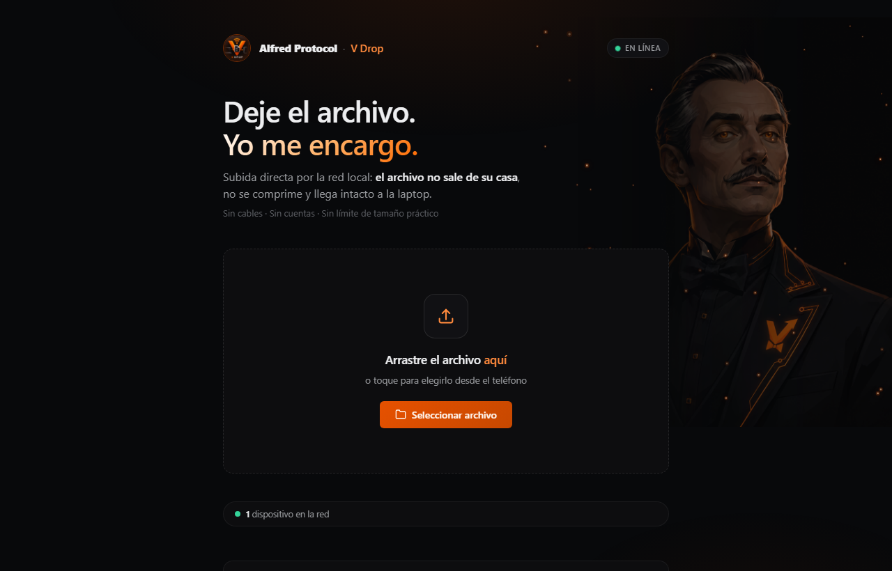
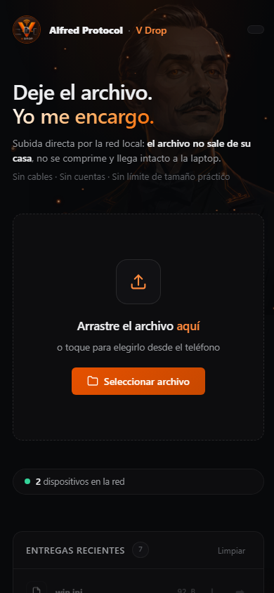

# V Drop

**Comparte archivos por tu propio WiFi, estilo AirDrop — sin nube, sin cuentas, sin cables.**

V Drop es un hub de transferencia de archivos por LAN, diminuto y sin dependencias.
Córrelo en cualquier computadora de tu casa, abre una URL desde el celular y envía
archivos directo a la laptop — o entre cualquier dispositivo de la misma red, con
flujo de aceptar/rechazar. Los archivos nunca salen de tu casa.

Construido solo con la librería estándar de Python (`http.server`) y JavaScript
puro. Cero dependencias, cero instalaciones en el celular, funciona en iPhone y Android.



*V Drop en el celular:* 

## Funciones

- **Celular → laptop en un toque** — arrastra o elige un archivo; cae en `uploads/` del servidor, sin cortes ni compresión.
- **Entre dispositivos** — envía un archivo a cualquier otro dispositivo de la red: el receptor recibe el aviso en vivo **"Aceptar / Rechazar"** y luego descarga.
- **Descubrimiento en vivo** — una barra de presencia muestra quién está en línea; los dispositivos se nombran solos según su modelo ("iPhone", "Pixel 8", "PC Windows") y se pueden renombrar una vez (el nombre persiste por dispositivo).
- **Reenviar o volver a descargar** — el historial permite empujar un archivo a otro dispositivo (➦) o descargarlo de vuelta al dispositivo actual (⬇).
- **Sin límite de tamaño en la práctica** — tope de 10 GB, transmite archivos grandes en streaming.
- **Instalable como PWA** — "Añadir a pantalla de inicio" la convierte en app; funciona sin internet.
- **Cero dependencias** — solo stdlib de Python + JS vanilla. Corre en Windows, macOS y Linux.

## Cómo funciona

V Drop es un servidor **hub-and-spoke**: una máquina (normalmente la laptop) corre
`server.py` y se convierte en el hub. Cada dispositivo se conecta por tu WiFi (LAN)
e intercambia archivos a través de él. Nada sale a internet.

```
        ┌──────────────┐
        │   Tu WiFi    │
        │              │
  iPhone │              │ Android
    ─────┼─── laptop ──┼─────
   (hub: server.py     │
     en puerto 8080)   │
                       │
                 Otra laptop
```

## Inicio rápido (Windows)

1. **Instala Python 3.8+** desde [python.org](https://python.org) (marca "Add to PATH").
2. **Descarga** este repositorio (Code → Download ZIP) y descomprímelo.
3. **Ejecuta `start.bat`** — el servidor arranca en segundo plano en el puerto 8080.
4. **Firewall (una vez):** clic derecho en `firewall-admin.bat` → *Ejecutar como administrador*.
   Sin esto, Windows bloquea la conexión desde el celular.
5. **Obtén la URL:** abre `data\last_url.txt` — se ve así:
   `http://192.168.x.x:8080/?k=<token>`. El `?k=` es tu llave privada de acceso.
6. En el celular (mismo WiFi), abre esa URL en el navegador y suelta un archivo.

> **Tip — un enlace que nunca cambia:** el router puede reasignar la IP de la laptop.
> Fija una IP estática para el equipo (Windows: Configuración → Red → tu adaptador →
> Asignación de IP → Editar → Manual) o resérvala en el DHCP del router. Así el
> enlace funciona siempre y puedes guardarlo en el celular.

### Enviar entre dispositivos

1. Abre V Drop en **ambos** dispositivos (mismo WiFi).
2. Elige un archivo en uno. Aparece la capa **"Enviar a…"** con la lista de
   dispositivos en línea. Elige destino — o "Solo a la laptop" para solo guardarlo.
3. El receptor ve **«Nombre» quiere enviarte…** con **Aceptar / Rechazar**.
4. Al aceptar, el archivo se descarga en el receptor.

## macOS / Linux

```bash
python3 server.py            # o: python server.py
```

- El servidor imprime la URL con su token. Ábrela desde cualquier dispositivo de la red.
- **Firewall (macOS):** permite conexiones entrantes para Python cuando lo pida, o
  `sudo /usr/libexec/ApplicationFirewall/socketfilterfw --add python3`.
- **Firewall (Linux):** si usas ufw, `sudo ufw allow 8080/tcp`.

## Opciones de línea de comandos

| Flag | Significado |
|---|---|
| `--port 9000` | Usar otro puerto (por defecto 8080) |
| `--no-token` | Desactivar el token de acceso (¡solo en redes de confianza!) |

## Modelo de seguridad

V Drop está diseñado para **redes domésticas de confianza** — léelo antes de exponerlo en cualquier otro lado.

- **Acceso por token:** la URL de la página lleva un token aleatorio (`?k=...`). Cualquiera en
  la red que tenga la URL puede subir/descargar. Trata la URL como una contraseña.
- **Shell público, API privada:** el shell HTML/CSS/JS y el manifest PWA se sirven
  sin autenticación (no contienen datos y jamás revelan el token); toda llamada a la
  API exige token. La app guarda el token en el navegador y lo envía como header.
- **Solo LAN:** el servidor escucha en todas las interfaces pero está pensado para
  quedarse detrás del NAT de tu router. **No** hagas port-forward del 8080 ni lo
  expongas a internet — no hay TLS ni cuentas de usuario.
- **Control de descarga:** las transferencias entre dispositivos requieren que el
  receptor acepte primero; solo el destinatario (verificado por IP) puede descargar.
- **Endurecido por defecto:** subidas en streaming (sin bombas de RAM de 10 GB),
  validación de Host contra DNS-rebinding, límites de conexiones/dispositivos/
  transferencias, guarda de symlinks, CSP.
- **Los archivos se quedan en casa:** nunca salen de tu red.
- Ver [SECURITY.md](SECURITY.md) para el modelo de amenazas completo, controles y límites.

## API (para curiosos)

Todos los endpoints aceptan `?k=<token>` o el header `X-Alfred-Token`.

| Método | Ruta | Propósito |
|---|---|---|
| POST | `/upload` | Subida multipart; campo opcional `to` = cid del dispositivo destino |
| GET | `/api/health` | Estado del servidor + versión |
| GET | `/api/history` | Subidas recientes |
| GET | `/api/download?name=<archivo>` | Descargar un archivo subido al dispositivo actual |
| POST | `/api/device` | Registrar/ping/renombrar este dispositivo `{cid, name, model, platform}` |
| GET | `/api/devices` | Listar dispositivos en línea |
| GET | `/api/events?cid=<id>` | Flujo SSE: `devices`, `transfer_request`, `transfer_accepted`, `transfer_declined` |
| POST | `/api/transfer` | Reenviar un archivo ya subido `{to, name, from}` |
| GET | `/api/transfers?cid=<id>` | Transferencias pendientes + recientes |
| PUT | `/api/transfers/<tid>/accept` | Aceptar (solo el destinatario) |
| DELETE | `/api/transfers/<tid>/decline` | Rechazar (solo el destinatario) |
| GET | `/api/transfers/<tid>/download` | Descargar una transferencia aceptada (solo el destinatario) |

## Desarrollo

```bash
# instancia de prueba en el puerto 8090 (no toca un 8080 en producción)
python server.py --port 8090

# smoke test: 23 verificaciones del flujo completo (registro, SSE, aceptar, rechazar, descargar)
# IMPORTANTE: correr contra un servidor en modo token en 8090 (no --no-token)
python test/v2_smoke.py
# esperado: RESULTADO: 23 OK / 0 FAIL
```

El servidor es un único `server.py` — sin build, sin gestor de paquetes.
`python server.py --port 8090 && python test/v2_smoke.py` es la verificación
de un solo comando de que el clon funciona.

## Ejemplos de API

```bash
TOKEN=$(cat data/token.txt)

# subir un archivo
curl -F "files=@foto.jpg" "http://<ip>:8080/upload?k=$TOKEN"

# listar subidas recientes
curl "http://<ip>:8080/api/history?k=$TOKEN"

# descargar un archivo subido de vuelta a este dispositivo
curl -OJ "http://<ip>:8080/api/download?name=foto.jpg&k=$TOKEN"

# registrar este dispositivo (para que otros puedan enviarle)
curl -X POST -H "Content-Type: application/json" \
     -d '{"cid":"mi-cel","name":"Mi Celular","model":"Pixel 8","platform":"phone"}' \
     "http://<ip>:8080/api/device?k=$TOKEN"
```

## Solución de problemas

| Síntoma | Solución |
|---|---|
| El celular no conecta | Ejecutar `firewall-admin.bat` como admin una vez; revisar que ambos estén en el mismo WiFi; desactivar AP isolation en el router si está activado |
| La URL dice `127.0.0.1` | No hay ruta por defecto — obtener la IP LAN con `ipconfig` (Windows) / `ifconfig` (Mac/Linux) y usarla manualmente |
| El enlace deja de funcionar tras reiniciar el router | Cambió la IP del DHCP — fijar IP estática en la PC o reserva DHCP en el router |
| Puerto 8080 ocupado | Usar `python server.py --port 9000` y abrir la URL nueva |
| La página muestra "Enlace sin acceso" | Falta `?k=...` en la URL — usar la URL completa que te dieron, o se borró el token (limpiar datos del sitio y abrir la URL completa) |
| La subida falla con 503 | Demasiadas subidas simultáneas — esperar y reintentar (máx. 3 a la vez) |

## Estructura del proyecto

```
v-drop/
├─ server.py            # todo el servidor (solo stdlib de Python)
├─ start.bat            # lanzador de Windows
├─ firewall-admin.bat   # regla de firewall de Windows (una vez, como admin)
├─ public/
│  ├─ index.html        # la app web (JS vanilla, PWA)
│  └─ static/           # íconos + arte
├─ test/
│  └─ v2_smoke.py       # smoke test de punta a punta
├─ uploads/             # archivos recibidos (se crea al correr)
└─ data/                # token, historial, dispositivos, transferencias (se crea al correr)
```

## Licencia

MIT — ver [LICENSE](LICENSE). Construido por [Juan Pareja](https://github.com/JuanParejaGutierrez)
con Alfred Protocol.
