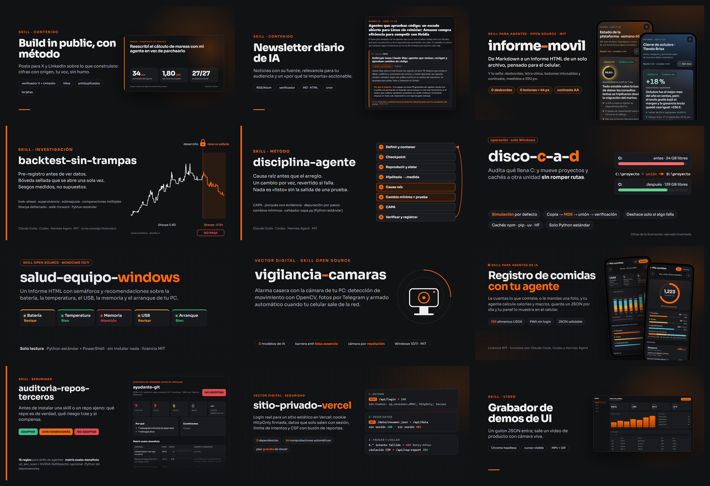

# Vector Digital · Skills para agentes de IA

[](https://github.com/vector-digital-studios/vector-digital-skills/actions/workflows/validar.yml)


**16 skills que usamos de verdad, a diario, en la operación de [Vector Digital Studios](https://github.com/vector-digital-studios)**,
limpiadas para que funcionen en tu máquina. Cada una trae su prueba automática, demo real y documentación en
español e inglés. Funcionan en **Claude Code, Codex, Hermes Agent** o cualquier agente que lea `SKILL.md`.



## Por qué existe este repo

Los agentes de IA ya escriben código, informes y contenido. Lo que les falta es **método**: saber cuándo algo
está terminado, cómo probarlo y qué no deben tocar. Estas skills nacieron de fallos reales en producción y cada
regla tiene detrás un incidente que no queremos repetir. No publicamos nada que no hayamos usado.

## Catálogo

| Dominio | Skill | Qué resuelve | Versión |
|---|---|---|---|
| datos | [informe-movil](skills/datos/informe-movil/) | Markdown → informe HTML de un solo archivo pensado para el celular, **sellado** con pruebas reales a 390 px (desbordes, letra chica, botones intocables, contraste) | 1.0.0 |
| salud | [registro-comidas](skills/salud/registro-comidas/) | Le cuentas a tu agente (o le mandas una foto) lo que comiste → calorías y macros con base USDA → JSON por día → panel PWA sin servidor ni login | 1.0.0 |
| seguridad | [ciberseguridad-vibecoder](skills/seguridad/ciberseguridad-vibecoder/) | Audita y blinda webs, apps, juegos y funciones de IA hechas con agentes: 44 controles, escáner pasivo y puerta antes de publicar | 1.1.0 |
| seguridad | [sitio-privado-vercel](skills/seguridad/sitio-privado-vercel/) | Login real para un sitio estático en Vercel: cookie HttpOnly firmada, datos solo con sesión, límite de intentos y CSP con buzón de reportes, sin dependencias | 1.0.0 |
| seguridad | [auditoria-repos-terceros](skills/seguridad/auditoria-repos-terceros/) | Antes de instalar un repo o una skill ajena: seguridad + costo-beneficio → ADOPTAR / CON CONDICIONES / NO ADOPTAR | 1.0.0 |
| operación | [vigilancia-camaras](skills/operacion/vigilancia-camaras/) | Alarma casera con la cámara del PC: OpenCV sin modelos de IA, alertas con foto por Telegram, armado automático cuando tu celular sale de casa | 1.0.0 |
| operación | [salud-equipo-windows](skills/operacion/salud-equipo-windows/) | Diagnóstico de batería, temperatura, USB, memoria y arranque en Windows, con informe de semáforos | 1.0.0 |
| operación | [v-drop](skills/operacion/v-drop/) | "AirDrop" casero: pasa archivos entre el celular y el PC por tu propio WiFi, sin nube ni cuentas, cero dependencias | 2.0.0 |
| operación | [disco-c-a-d](skills/operacion/disco-c-a-d/) | Qué llena tu C: y cómo mover proyectos y cachés (npm, uv, Hugging Face…) a otra unidad **sin romper rutas** | 1.0.0 |
| método | [consejo-decisiones](skills/metodo/consejo-decisiones/) | Un consejo de 9 papeles que delibera a ciegas sobre tus decisiones difíciles (contra la complacencia), con sala sellada y registro de predicciones | 0.3.1 |
| método | [disciplina-agente](skills/metodo/disciplina-agente/) | Causa raíz antes del arreglo: depuración por pasos, cambios mínimos y acciones correctivas (CAPA) con validador | 1.0.0 |
| investigación | [backtest-sin-trampas](skills/investigacion/backtest-sin-trampas/) | Investigar estrategias sin autoengaño: pre-registro, bóveda sellada que no se puede espiar, control de sesgos | 1.0.0 |
| contenido | [build-in-public](skills/contenido/build-in-public/) | Posts de "construir en público" para X y LinkedIn con cifras verificables y un verificador de estilo | 1.0.0 |
| contenido | [newsletter-ia](skills/contenido/newsletter-ia/) | Newsletter diario de IA: fuentes RSS configurables, selección por impacto, cada noticia citada | 1.0.0 |
| video | [grabador-demos-ui](skills/video/grabador-demos-ui/) | Guion JSON → video de producto MP4/GIF de tu interfaz web, con cursor visible y cámara que sigue la acción | 1.0.0 |
| video | [teleprompter](skills/video/teleprompter/) | Teleprompter por voz en el navegador: el guion avanza mientras hablas, modo manual y ventana siempre al frente en Windows. Basado en el proyecto MIT de Julien Lecomte | 0.6.0-beta |

## Instalar

Cada skill es independiente: puedes instalar una sola, un dominio o todas.

**Claude Code** (como plugin; se actualiza solo):
```
/plugin marketplace add vector-digital-studios/vector-digital-skills
/plugin install completo@vector-digital-skills      # todas
/plugin install seguridad@vector-digital-skills     # solo un dominio
```
Dominios: `datos`, `salud`, `seguridad`, `operacion`, `metodo`, `investigacion`, `contenido`, `video`.

**Cualquier agente** (Codex, Hermes, Claude Code sin plugins):
```
git clone https://github.com/vector-digital-studios/vector-digital-skills.git
cp -r vector-digital-skills/skills/*/* ~/.claude/skills/            # todas
cp -r vector-digital-skills/skills/seguridad/sitio-privado-vercel ~/.claude/skills/   # solo una
```
(Para Codex usa `~/.codex/skills/`; para Hermes, `~/.hermes/skills/<categoría>/`.)

## Estándar de calidad (lo que exige el CI a cada skill)

1. `SKILL.md` con frontmatter válido (`name`, `description` ≤ 80 caracteres, `version` semver, `license`).
2. `README.md` y `CHANGELOG.md` propios, con demo real y sección en inglés.
3. Una prueba automática (`scripts/autoprueba.py`) que pasa en cada cambio, sin red ni llaves.
4. Saneado: sin rutas personales, correos, claves ni datos de clientes (`tools/validar.py` + escáner de secretos en toda la historia de Git).
5. Créditos de toda idea ajena, aunque no se haya copiado código.

## Estructura

```
skills/<dominio>/<skill>/   SKILL.md · README.md · CHANGELOG.md · assets/ · references/ · scripts/ · templates/
tools/validar.py            puerta de calidad (local y CI)
.claude-plugin/             catálogo instalable en Claude Code (un plugin por dominio)
```

## Contribuir

Issues y pull requests bienvenidos. Antes de abrir un PR corre `python tools/validar.py` (debe terminar en `OK`).
Si propones una skill nueva, cuéntanos en qué proyecto real la usaste: es nuestro único requisito de entrada.

## Licencia y uso

MIT. Las herramientas de auditoría son pasivas y están pensadas **solo para activos propios o con
autorización escrita**; la vigilancia con cámaras, solo en espacios propios. Se entregan sin garantía: una
auditoría reduce riesgo, no lo elimina. Para reportar un problema de seguridad en este repo, ver [SECURITY.md](SECURITY.md).

---

## English

**16 production-tested skills for AI coding agents** (Claude Code, Codex, Hermes Agent, or anything that reads
`SKILL.md`), written in Spanish with full English sections in every README. Each skill ships with an automated
self-test, a real demo and no private data. Highlights: **informe-movil** (Markdown → mobile-first HTML report,
verified at 390 px), **registro-comidas** (log meals by chatting with your agent → JSON + serverless PWA),
**sitio-privado-vercel** (real login for static Vercel sites, zero dependencies), **auditoria-repos-terceros**
(audit third-party repos/skills before installing), **backtest-sin-trampas** (pre-registered research with a
sealed holdout), and a set of Windows operations skills (camera alarm with Telegram, hardware health, freeing
C: without breaking paths).

Install in Claude Code with `/plugin marketplace add vector-digital-studios/vector-digital-skills`, then
`/plugin install completo@vector-digital-skills` (everything) or `/plugin install <domain>@vector-digital-skills`. Every skill is self-contained. MIT licensed.
