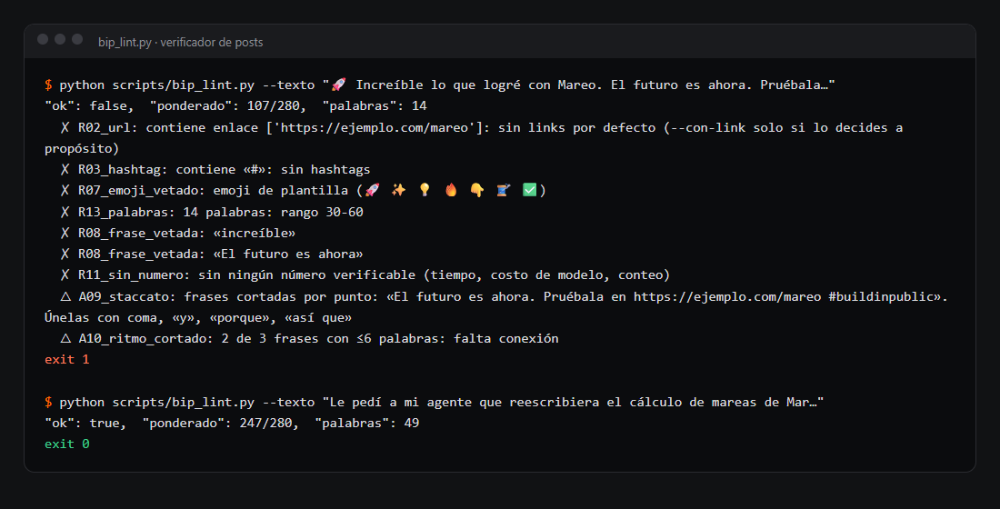
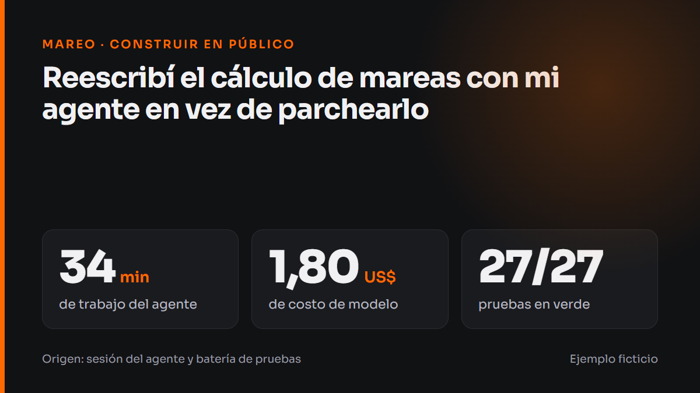
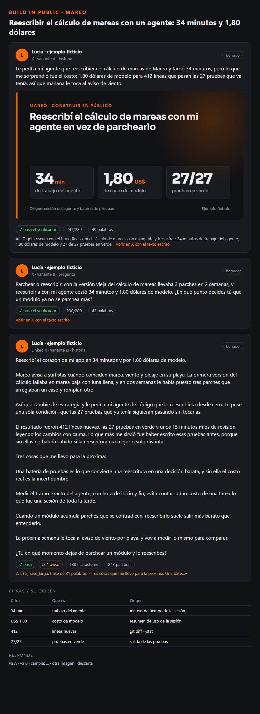

# Build in public, con método

**Convierte lo que construiste hoy en posts para X y LinkedIn con tu voz, cifras que tienen origen y un verificador que no deja pasar links, hashtags ni frases de plantilla.**

   


## El problema
Contar lo que construyes funciona, pero los posts que escribe un agente suenan a agente: «increíble»,
«el futuro es ahora», tres hashtags y un enlace que nadie abre. Peor aún, inventan o redondean cifras.
Y si escribes tú, cada post te cuesta media hora y nunca sabes si ya contaste eso la semana pasada.

## Qué hace
- **Método en 7 pasos** para el agente: compuerta de verdad → ficha con cifras y su origen →
  antiduplicados → variantes → verificador → pieza visual → entrega en un solo mensaje.
- **Tu voz en un archivo** (`voz.md`): quién habla, tono, ejemplos y una lista roja configurable
  (tu empleo, tus datos personales, proveedores que no quieres nombrar). Incluye una voz de ejemplo ficticia.
- **Verificador determinista** para X (280 ponderados como X, 30-60 palabras, primera persona, al menos
  un número) y LinkedIn (gancho ≤140, banda 1.300-2.500, sin jerga de X ni cierres genéricos).
- **Hilos** numerados y verificados, con enlace permitido solo en la etapa final «recurso».
- **Registro local** con estados (borrador → pendiente → publicado) y **antiduplicados** contra lo que ya publicaste.
- **Tarjetas** 1200x675 con tus métricas y **vista previa** HTML/PNG con veredictos y el origen de cada cifra.
- Publicación **siempre manual**: te deja el texto listo y un enlace que abre X con el texto escrito.

## Demo
Salida real de la herramienta con el proyecto **inventado** «Mareo» (app de mareas para surfistas) y
la voz de ejemplo. Primero, el verificador rechazando un post de plantilla y aprobando uno con método:



La tarjeta generada con `scripts/tarjeta.py` desde `templates/ejemplo/tarjeta.json`:



Y la vista previa que recibe la persona (`scripts/vista_previa.py`): variantes de X y LinkedIn,
conteos, veredictos, avisos y cifras con su origen:



## Por qué es distinto
| | Esta skill | Plantillas de hilos | Typefully / Taplio | Pedírselo al chat |
|---|---|---|---|---|
| Parte de lo que realmente hiciste (con origen de cada cifra) | Sí | No | No | A veces |
| Tu voz, configurable y versionable | Sí (archivo) | No | Parcial | No |
| Bloquea links, hashtags, muletillas de IA | Sí, determinista | No | No | No |
| Antiduplicados contra lo ya publicado | Sí | No | No | No |
| Programa y publica por ti | **No** (a propósito) | No | Sí | No |
| Coste | Gratis, MIT | Gratis | De pago | Según modelo |

Si lo que buscas es programar publicaciones y analítica, Typefully o Taplio hacen eso mejor. Esto
resuelve el paso anterior: que lo que publiques sea verdad, suene a ti y no se repita.

## Instalación
**Claude Code (marketplace):**
```
/plugin marketplace add vector-digital-studios/vector-digital-skills
/plugin install contenido@vector-digital-skills
```
**Copia manual** de la carpeta `build-in-public/` a:
- Claude Code: `~/.claude/skills/build-in-public/`
- Codex: `~/.codex/skills/build-in-public/`
- Hermes Agent: `~/.hermes/skills/contenido/build-in-public/`

Compatible con cualquier agente que lea `SKILL.md`. Luego:
```bash
mkdir -p ~/.build-in-public && cp templates/voz.example.md ~/.build-in-public/voz.md   # y edítalo
export BIP_VOZ=~/.build-in-public/voz.md
python scripts/autoprueba.py        # 33 comprobaciones, sin red ni navegador
```
**Requisitos:** Python 3.9+ (solo biblioteca estándar). Para PNG de tarjeta y vista previa:
Chrome, Chromium o Edge (autodetectado o `CHROME_PATH`).

## Uso
**1. Pedírselo al agente al cerrar una tarea:**
> «Invoca build in public con lo que acabamos de hacer: la reescritura del cálculo de mareas.»

El agente arma la ficha desde la sesión (minutos por marcas de tiempo, costo de modelo, pruebas),
redacta A y B, las verifica, genera la tarjeta y te entrega todo en un mensaje para que respondas `va A`.

**2. Verificar un texto tuyo (salida real):**
```bash
python scripts/bip_lint.py --texto "🚀 Increíble lo que logré con Mareo. El futuro es ahora. Pruébala en https://ejemplo.com/mareo #buildinpublic"
# "ok": false · R02_url · R03_hashtag · R07_emoji_vetado · R13_palabras (14) · R08 «increíble»
# R08 «El futuro es ahora» · R11_sin_numero · avisos A09_staccato, A10_ritmo_cortado   → exit 1
python scripts/bip_lint.py --canal linkedin --archivo post_linkedin.txt
```

**3. Hilo y registro:**
```bash
python scripts/hilo.py templates/ejemplo/hilo.json      # 5 posts «1/5 …», 157-186 ponderados → exit 0
python scripts/registro.py alta --post templates/ejemplo/post.json
python scripts/registro.py dedupe --texto "…"           # BLOQUEADO si casi repite algo publicado
```

## Cómo funciona
```
sesión / commits / pruebas ─► ficha.json (cifras + origen) ─► borradores A/B · hilo · LinkedIn
                                                               │
              voz.md (persona + bloque json) ──► bip_lint.py ──┤ exit 0 / motivos / avisos
                                                 hilo.py ──────┤
                         registro.py (jsonl, estados, dedupe) ─┤
                    tarjeta.py · vista_previa.py (Chrome headless) ─► mensaje único ─► publicas tú
```
- `bip_lint.py`: longitud ponderada (URL = 23, emoji/CJK = 2), reglas duras R0x-R17 y L0x-L25, avisos A0x.
- `registro.py`: log append-only; un hito publicado no se reabre; dedupe por similitud de trigramas y apertura.
- `references/metodo.md`: el método completo (lente del lector, concretismo, piezas, hilos, canales).

## Configuración
Todo vive en tu archivo de voz (bloque `json`): `lista_roja` (categorías `aviso_*` solo avisan),
`frases_vetadas_extra`, `terminos_internos` (nombre interno → explicación para el lector),
`siglas_conocidas`, y umbrales por canal (`canal_x`, `canal_linkedin`). Variables: `BIP_VOZ`,
`BIP_DATOS` (registro, por defecto `~/.build-in-public/`), `CHROME_PATH`.

## Límites conocidos
- Las reglas de estilo están escritas para **español**; en otro idioma hay que adaptar frases vetadas y
  detección de primera persona.
- La longitud ponderada es una aproximación fiel de twitter-text para texto latino y emoji comunes;
  scripts asiáticos mixtos pueden desviarse unos caracteres.
- Los umbrales de LinkedIn son prudentes, no leyes: la evidencia pública sobre su algoritmo es débil.
- No publica ni programa nada; no mide resultados. La analítica es tuya.
- Tarjeta y vista previa probadas en Windows 11 con Chrome y Chromium de Playwright; macOS/Linux no probados.

## Roadmap
- Plantillas de pieza «antes/después» y «rechazo» (un fallo que tu sistema cazó).
- Propuestas automáticas de ajuste de voz a partir de `voz_ediciones.jsonl`.
- Reglas de estilo para inglés.

## Créditos
- Fuente **Sora** (© The Sora Project Authors), SIL Open Font License 1.1: `templates/fonts/OFL-Sora.txt`.
- Método y verificadores desarrollados y usados internamente por Vector Digital Studios (23 usos
  desde oct-2026); esta versión pública reemplaza la voz personal por un archivo configurable.

## Licencia
MIT. Ver `LICENSE` en la raíz del repositorio.

---

## English

**Build in public, with a method** — turn what you built today into X and LinkedIn posts in your own
voice, with numbers that have a source, and a deterministic checker that blocks links, hashtags and
AI-template phrasing.

**Problem:** agent-written posts sound like agents (hype words, hashtags, links) and often invent or
round numbers; writing them yourself is slow and you never know if you already told that story.

**What it does:** a 7-step method for the agent (truth gate → fact sheet with each number's source →
duplicate check → variants → checker → visual → single delivery message); your voice in a Markdown
file with a JSON config block (example persona included, fictional); checkers for X (twitter-text
weighted length, 30-60 words, first person, at least one number) and LinkedIn (≤140-char hook,
1,300-2,500 chars, no X jargon or generic closers); numbered threads; a local registry with states and
duplicate detection; 1200x675 metric cards and an HTML/PNG preview. Publishing is always manual.

**Demo:** real outputs above, generated for a made-up project («Mareo», a surf tide app).

**Install:** `/plugin marketplace add vector-digital-studios/vector-digital-skills` then
`/plugin install contenido@vector-digital-skills`, or copy the folder to `~/.claude/skills/`,
`~/.codex/skills/` or `~/.hermes/skills/contenido/`. Python 3.9+ standard library only; Chrome/Chromium/Edge
for PNG output. Run `python scripts/autoprueba.py` (33 checks, offline).

**Limits:** style rules target Spanish; weighted length is a close approximation; LinkedIn thresholds
are conservative; no scheduling or analytics; PNG rendering tested on Windows 11 only.

**Credits:** Sora font (OFL 1.1). Method built and used in-house by Vector Digital Studios (23 uses
since Oct 2026). **License:** MIT.
