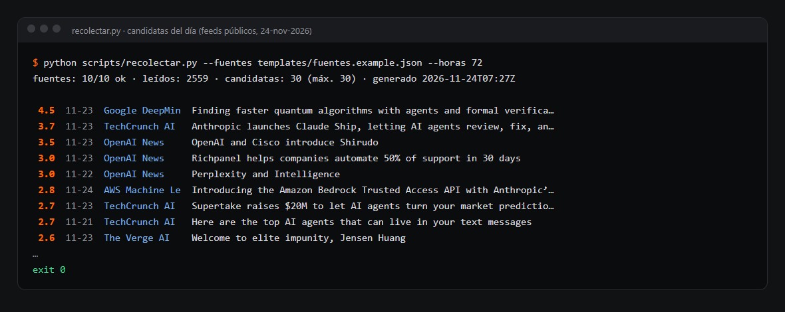
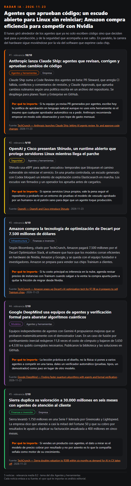

# Newsletter diario de IA

**Cada mañana, N noticias de IA con su fuente, una relevancia pensada para tu audiencia y un «por qué te importa» que dice qué hacer. Con puerta de calidad que rechaza noticias sin fuente, viejas o infladas.**

   


## El problema
Hay decenas de newsletters de IA y casi todos son iguales: la misma lista de lanzamientos, sin decirte
qué cambia para ti. Si le pides a un agente que te haga el tuyo, el riesgo es peor: enlaces inventados,
noticias de hace tres meses que aparecían en la portada de un agregador y adjetivos donde debería haber cifras.

## Qué hace
- **Recolector sin LLM ni claves**: lee feeds RSS/Atom públicos, filtra por ventana de horas, descarta
  por criterio (webinars, patrocinados), deduplica la misma historia entre medios y pre-ordena por
  peso de fuente y palabras clave.
- **Método editorial** para el agente: abrir la fuente primaria, confirmar la fecha real, elegir con
  una rúbrica 1-10 según tu audiencia y escribir un «por qué te importa» accionable.
- **Puerta de calidad** (`verificar.py`): número exacto de noticias, URL única y fuente en cada una,
  fecha dentro de la ventana, taxonomía y colores, meta coherente, sin palabras de humo, índice íntegro.
- **Salidas** en JSON, Markdown y HTML de una columna con estilos en línea (email y móvil) + `index.json`.
- **Programable** con el cron de Hermes, GitHub Actions o la tarea programada del sistema.

## Demo
Edición de ejemplo con **noticias reales y públicas del 23-nov-2026**, elegidas con el recolector sobre
los 10 feeds de `templates/fuentes.example.json` y comprobadas abriendo cada fuente el 24-nov-2026
(`templates/ejemplo-edicion.json`). El «por qué te importa» es opinión editorial del ejemplo.

El recolector en vivo (10/10 feeds, 2.559 entradas leídas, 30 candidatas):



La edición generada en HTML (ancho móvil):



## Por qué es distinto
| | Esta skill | Newsletters de IA existentes | Feedly AI / lectores con IA | Plantillas n8n / Zapier |
|---|---|---|---|---|
| Lente propia (tu audiencia, tu pregunta de impacto) | Sí, configurable | No | Parcial (filtros) | Depende del prompt |
| Fuente enlazada y verificada por noticia | Obligatorio (verificador) | Normalmente sí | Sí | No se comprueba |
| Rechaza noticias viejas o sin fuente | Sí, automático | Editorial humana | No | No |
| Salida propia (JSON/MD/HTML) en tu repo | Sí | No | No | Sí |
| Coste | Gratis, MIT (+ el modelo que redacta) | Gratis o de pago | De pago | Plan + API |

Si solo quieres leer, suscríbete a un buen newsletter. Esto sirve cuando quieres **el tuyo**: con tu
criterio, para tu equipo o tu audiencia, y sin que un agente pueda colarte una noticia inventada.

## Instalación
**Claude Code (marketplace):**
```
/plugin marketplace add vector-digital-studios/vector-digital-skills
/plugin install contenido@vector-digital-skills
```
**Copia manual** de la carpeta `newsletter-ia/` a:
- Claude Code: `~/.claude/skills/newsletter-ia/`
- Codex: `~/.codex/skills/newsletter-ia/`
- Hermes Agent: `~/.hermes/skills/contenido/newsletter-ia/`

Compatible con cualquier agente que lea `SKILL.md` y tenga búsqueda/lectura web. Luego copia y ajusta
`templates/fuentes.example.json` y ejecuta `python scripts/autoprueba.py` (22 comprobaciones, sin red).
**Requisitos:** Python 3.9+ (solo biblioteca estándar). La redacción necesita un agente con acceso web.

## Uso
**1. Pedírselo al agente:**
> «Genera la edición de ayer del newsletter con mis fuentes de `~/newsletter/fuentes.json` y déjala en `ediciones/`.»

**2. Recolectar y verificar a mano (salida real):**
```bash
python scripts/recolectar.py --fuentes templates/fuentes.example.json --horas 72 --max 30 --salida candidatas.json
# 10/10 fuentes ok · 2559 leídas · 30 candidatas · la primera: DeepMind, agentes + verificación formal (4.5)
python scripts/verificar.py templates/ejemplo-edicion.json --config templates/fuentes.example.json
# {"ok": true, "edicion": "2026-11-23", "items": 5, "motivos": []}
python scripts/generar.py templates/ejemplo-edicion.json --index ediciones/index.json
# → ejemplo-edicion.md + ejemplo-edicion.html + index.json
```
Una edición con un problema no pasa: p. ej. `"noticia 4: la fuente es del 2026-10-01 (> 3 días de la
edición): noticia vieja"` y exit 1.

**3. Programarlo con Hermes (cron diario a las 8:00):**
```bash
hermes cron create "0 8 * * *" "$(cat templates/programar/prompt-agente.md)" \
  --name "Newsletter IA" --skill newsletter-ia --timezone America/Lima --deliver local
```
GitHub Actions y crontab / Programador de tareas: `references/programar.md`.

## Cómo funciona
```
feeds RSS/Atom ─► recolectar.py ─► candidatas.json (ventana, descarte, dedupe, puntaje heurístico)
                                         │
     agente: abre fuentes, confirma fechas, elige N con la rúbrica, escribe impacto
                                         │
                         edicion.json ─► verificar.py ─(exit 0)─► generar.py ─► .md · .html · index.json
                                                                        └─► resumen de impacto al que programó
```
Documentación: `references/criterios.md` (rúbrica, reglas de verdad, taxonomía),
`references/formato.md` (esquema y reglas del verificador), `references/programar.md` (tres vías).

## Configuración
`fuentes.json`: `newsletter` (nombre, audiencia, items, pregunta de impacto), `fuentes` (url, tipo
primaria/medio, peso), `criterios` (ventana_horas, palabras_clave con peso, descartar_si, rúbrica),
`categorias` (nombre → color y palabras clave). El verificador acepta `--items`, `--relevancia-min` y
`--ventana-dias`.

## Límites conocidos
- La calidad depende del agente que redacta: los scripts impiden lo grave (sin fuente, viejas, URL
  repetida, meta incoherente), pero no comprueban que el resumen diga lo mismo que el artículo.
- Muchos laboratorios no publican RSS (en la prueba: Anthropic y Meta AI dieron 404; un medio dio 429).
  Por eso el método pide complementar con búsqueda web.
- El recolector puntúa con palabras clave en inglés; para feeds en otro idioma, añade sus términos.
- El workflow de GitHub Actions se validó como YAML y sus comandos se ejecutaron en local, **no en GitHub**;
  el paso de redacción con agente viene comentado y sin probar.
- El cron de Hermes del ejemplo se comprobó contra `hermes cron create --help`, no se creó ninguna tarea.

## Roadmap
- Comprobación automática de que cada URL responde (opcional, con red).
- Plantilla de email con versión de texto plano.
- Edición semanal que agregue las diarias.

## Créditos
- Noticias del ejemplo: TechCrunch, OpenAI, Google DeepMind (enlazadas a su fuente; los resúmenes son
  propios y en español).
- Desarrollada y usada internamente por Vector Digital Studios: tarea diaria desde jul-2026, 127 usos
  de la skill. Esta versión pública sustituye la marca, las fuentes propias y la publicación interna por
  configuración.

## Licencia
MIT. Ver `LICENSE` en la raíz del repositorio.

---

## English

**Daily AI newsletter** — every morning, N AI news items with their source, a relevance score for
your audience and an actionable "why it matters", behind a quality gate that rejects items without a
source, stale items or inflated wording.

**Problem:** generic AI newsletters don't tell you what changes for you; agent-made ones may invent
links, resurface months-old stories from aggregator front pages, and use adjectives instead of numbers.

**What it does:** a key-free collector (public RSS/Atom feeds, time window, exclusion rules, cross-outlet
dedupe, heuristic pre-ranking); an editorial method for the agent (open the primary source, confirm the
real date, 1-10 rubric, actionable impact); a verifier (exact item count, unique URL and source per item,
date window, taxonomy and colors, consistent meta, no hype words, index integrity); JSON, Markdown and
inline-styled HTML output; scheduling via Hermes cron, GitHub Actions or OS schedulers.

**Demo:** a sample edition with real, public news from 23 Nov 2026, picked with the collector from 10
feeds and checked by opening each source on 24 Nov 2026 (`templates/ejemplo-edicion.json`).

**Install:** `/plugin marketplace add vector-digital-studios/vector-digital-skills` then
`/plugin install contenido@vector-digital-skills`, or copy the folder to `~/.claude/skills/`,
`~/.codex/skills/` or `~/.hermes/skills/contenido/`. Python 3.9+ standard library only; drafting needs an
agent with web access. Run `python scripts/autoprueba.py` (22 offline checks).

**Limits:** scripts can't check that a summary matches its article; many labs have no RSS (complement
with web search); keyword scoring is English-centric; the GitHub Actions workflow was validated as YAML
and run locally, not on GitHub; the Hermes cron command was checked against its `--help`, not created.

**Credits:** sample news from TechCrunch, OpenAI and Google DeepMind (linked; summaries are original, in
Spanish). Built and used in-house by Vector Digital Studios (daily since Jul 2026, 127 skill uses).
**License:** MIT.
