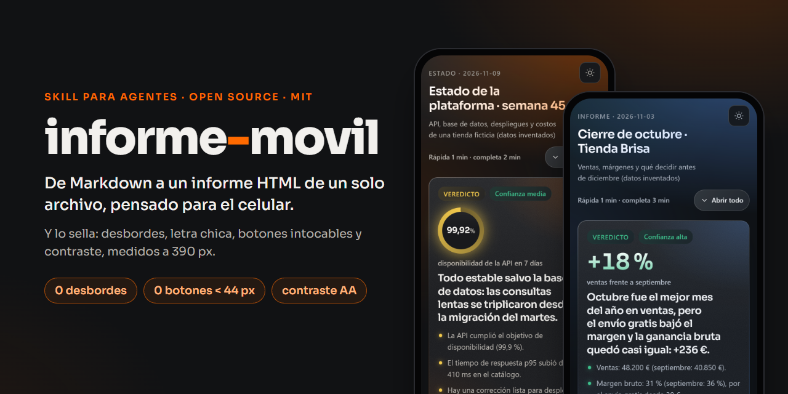
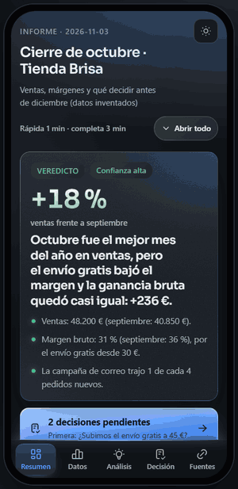
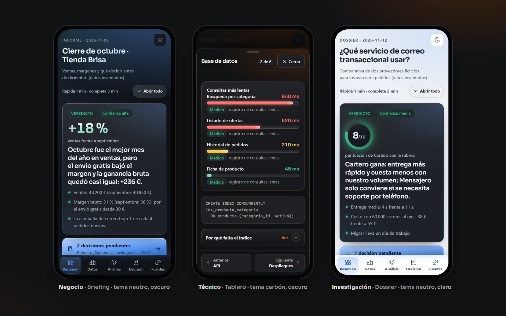
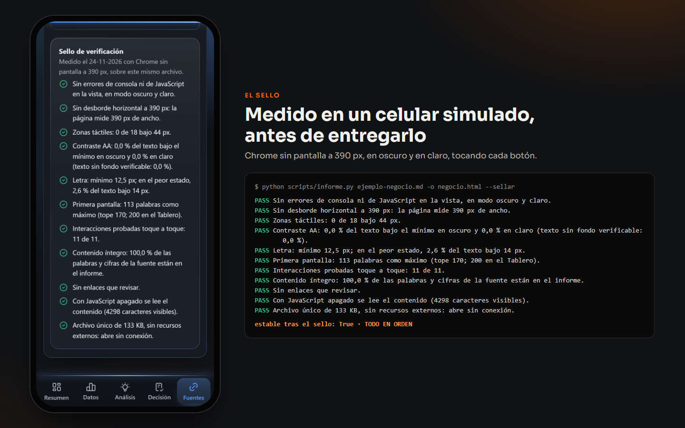

# informe-movil

**De Markdown a un informe HTML de un solo archivo que se lee bien en el celular — y sellado: medido a 390 px
antes de entregarlo.**

  



## El problema

Los agentes de IA escriben informes cada vez mejores, pero los entregan como Markdown crudo o como HTML que
en el teléfono se rompe: tablas que se salen de la pantalla, letra de 11 px, botones de 30 px imposibles de
tocar, texto gris sobre gris. Nadie lo revisa en un celular antes de enviarlo, y el lector lo descubre tarde.

## Qué hace

- **Un solo archivo HTML**: CSS, JavaScript, fuente (Sora) e iconos van dentro. Abre sin conexión, se puede
  mandar por cualquier chat y se lee aunque el JavaScript esté apagado.
- **El autor solo escribe contenido** en Markdown con bloques (`veredicto`, `kpis`, `ranking`, `vs`, `tabla`,
  `decision`, `pasos`, `grafica`, `matriz`, `glosario`, audio, vídeo…). 31 bloques documentados en
  [`references/formato.md`](references/formato.md). Ideal para agentes: el diseño nunca entra en su contexto.
- **Tres vistas** según el tipo de informe: Briefing (capas), Tablero (mosaico con hojas) y Dossier (pestañas).
- **Decisiones tocables**: el lector elige una opción por pregunta y «Copiar respuestas» le deja todo listo
  para pegarlo en el chat con el agente.
- **El sello** (`--sellar`): Chrome sin pantalla a 390×844, en modo oscuro y claro, mide desbordes, letra,
  zonas táctiles (≥ 44 px), contraste AA (también sobre degradados), palabras de la primera pantalla, prueba
  cada interacción toque a toque y comprueba que ≥ 98,5 % de las palabras y cifras de la fuente están en el
  HTML. El resultado queda **incrustado al final del propio informe**.
- **Temas** por variables CSS: `neutro` (por defecto), `carbon` (carbón/naranja) y `menta`; o el suyo propio.

## Demo







## Por qué es distinto

| | informe-movil | Pandoc / Quarto | mdBook / MkDocs | Lighthouse |
|---|---|---|---|---|
| HTML de un solo archivo | Sí, siempre | Sí, con `--embed-resources` | No (sitio) | — |
| Componentes para decidir (veredicto, KPI, decisiones copiables) | Sí | No de serie | No | — |
| Mide legibilidad móvil (desborde, letra, toque, contraste) | Sí, a 390 px, oscuro y claro | No | No | Audita una página (accesibilidad, rendimiento) |
| Prueba las interacciones del informe | Sí, toque a toque | No | No | No |
| Comprueba que no se perdió contenido de la fuente | Sí (≥ 98,5 %) | No | No | No |
| Alcance | Informes cortos y medianos, interfaz en español | Documentos, libros, webs, PDF | Documentación | Cualquier web |

No compite con Quarto o Pandoc en alcance: es una herramienta estrecha para que un informe de agente llegue
**legible y completo** a un teléfono, con prueba.

## Instalación

Requisitos: **Python 3** (solo biblioteca estándar; probado con 3.11 y 3.14). Para el sello, además:
**Node 22.12+**, **Chrome, Chromium o Edge** y `npm install` en `scripts/sello/` (instala `puppeteer-core`, que
no descarga navegador). Sin ellos el informe se genera igual, sin sello.

**Claude Code** (como plugin):
```
/plugin marketplace add vector-digital-studios/vector-digital-skills
/plugin install datos@vector-digital-skills
```

**Copia manual** (Claude Code, Codex, Hermes o cualquier agente que lea `SKILL.md`):
```bash
cp -r informe-movil ~/.claude/skills/            # o ~/.codex/skills/  o  ~/.hermes/skills/datos/
cd ~/.claude/skills/informe-movil/scripts/sello && npm install
python ../autoprueba.py                          # 103 de 103 comprobaciones · OK
```
Si Chrome no está en una ruta estándar: `export CHROME_PATH=/ruta/a/chrome` (en Windows, `set CHROME_PATH=…`).

## Uso

**1. Pedírselo al agente**
> «Carga informe-movil y hazme el informe del cierre de octubre para leerlo en el celular; séllalo.»

El agente escribe el `.md`, ejecuta el motor y entrega el `.html` con el sello.

**2. Construir a mano**
```
$ python scripts/informe.py templates/ejemplo-negocio.md -o negocio.html
OK negocio.html · 131 KB · 5 secciones · vista A · tema neutro
```

**3. Sellar**
```
$ python scripts/informe.py templates/ejemplo-negocio.md -o negocio.html --sellar
PASS  Sin errores de consola ni de JavaScript en la vista, en modo oscuro y claro.
PASS  Sin desborde horizontal a 390 px: la página mide 390 px de ancho.
PASS  Zonas táctiles: 0 de 18 bajo 44 px.
PASS  Contraste AA: 0,0 % del texto bajo el mínimo en oscuro y 0,0 % en claro (…)
PASS  Letra: mínimo 12,5 px; en el peor estado, 2,6 % del texto bajo 14 px.
PASS  Primera pantalla: 113 palabras como máximo (tope 170; 200 en el Tablero).
PASS  Interacciones probadas toque a toque: 11 de 11.
PASS  Contenido íntegro: 100,0 % de las palabras y cifras de la fuente están en el informe.
PASS  Sin enlaces que revisar.
PASS  Con JavaScript apagado se lee el contenido (4298 caracteres visibles).
PASS  Archivo único de 133 KB, sin recursos externos: abre sin conexión.
estable tras el sello: True · TODO EN ORDEN
```
`--previo` hace la misma medición sin estampar e imprime solo lo que falla. Otras opciones:
`--tema carbon|menta|mi-tema.css`, `--vista A|B|C`, `--modo comparar` (las tres vistas en un archivo).

## Cómo funciona

```
informe.md ──parse──▶ documento (secciones + bloques) ──render──▶ informe.html (un archivo)
                                                                    │
     --sellar:  Chrome sin pantalla 390×844 ◀───────────────────────┘
                ├─ qa.mjs      consola · desborde · letra · zonas táctiles · contraste · 1.ª pantalla · sin JS
                ├─ prueba.mjs  cada interacción, toque a toque (tema, plegables, tabla, decisiones, copiar)
                └─ paridad.py  palabras y cifras de la fuente presentes en el HTML · recursos externos
             ──▶ <salida>.sello.json ──▶ se reconstruye con el sello dentro y se vuelve a medir («estable»)
```
- El sello va ligado a una **huella** (contenido + vista + diseño + tema): si cambia algo, el informe vuelve a
  decir «Sin medir todavía».
- Regla de diseño para que el contraste sea medible: todo texto tiene un fondo sólido; los degradados van encima
  y se miden parada a parada.
- Herramientas de diagnóstico en `scripts/sello/`: `desborde3.mjs` (qué elemento ensancha la página),
  `tap.mjs` (zonas táctiles pequeñas con su HTML), `fuente.mjs`, `aire.mjs`, `clicables.mjs`, `primera.mjs`.

**Configuración** (variables de entorno): `CHROME_PATH`, `NODE`, `INFORME_TEMA` (tema por defecto),
`INFORME_PAR` (Chrome en paralelo, 2 por defecto), `INFORME_JERGA` (siglas extra que exigen glosario),
`INFORME_SIN_CHROME=1` (la autoprueba salta el sello).

## Probado en producción

Es el motor con el que un estudio pequeño entrega todos sus informes internos desde el 4-nov-2026:
**134 informes en 20 días** (4 al 23 de noviembre de 2026), 130 de ellos sellados y 119 con todas las
comprobaciones en verde. Esta versión pública es ese motor, sin la biblioteca de carpetas
ni el conversor de formatos antiguos, y con temas y CLI nuevos.

## Límites conocidos

- La interfaz del informe (botones, rótulos) está **solo en español**.
- El sello necesita Node + Chrome; sin ellos solo se valida la estructura y el contenido (sin navegador).
- Probado en **Windows 11** (Chrome 158, Node 22, Python 3.11 y 3.14). La detección de Chrome en macOS y Linux
  está escrita pero **no probada**.
- Los medios incrustados engordan el archivo: aviso sobre 25 MB, el sello falla sobre ~45 MB.
- El modo `comparar` repite los medios en cada vista.
- Pensado para informes de lectura, no para documentos de cientos de páginas.

## Roadmap

- Interfaz en inglés (`--idioma en`).
- Probar y publicar la detección de Chrome en macOS/Linux en CI.
- Exportar a PDF desde el mismo HTML sellado.

## Créditos

- Fuente **Sora** (Jonathan Barnbrook y Julián Moncada), SIL Open Font License 1.1 — incrustada en cada informe.
- Iconos **Tabler Icons** (Paweł Kuna), licencia MIT.
- **Puppeteer** (`puppeteer-core`), Apache-2.0, para las mediciones.
- Criterios de contraste de **WCAG 2.x** (W3C) y tamaño mínimo de toque de 44 px de las guías de interfaz de Apple.

## Licencia

MIT. Ver el archivo `LICENSE` del repositorio.

---

## English

**informe-movil** turns block-based Markdown into a **single-file HTML report built for phones** — and
**seals** it: it opens the report in headless Chrome at 390×844 (dark and light), measures overflow, font
size, tap targets (≥ 44 px), WCAG AA contrast (including over gradients) and first-screen word count, taps
every interactive element, and checks that ≥ 98.5 % of the source's words and figures made it into the HTML.
The result is embedded at the end of the report itself.

**Why:** AI agents write good reports but deliver them as raw Markdown or HTML that breaks on a phone. Nobody
checks on a phone before sending.

**What you get:** one self-contained file (CSS, JS, Sora font and icons inline; works offline and without
JavaScript) · 31 documented blocks (`veredicto`, `kpis`, `ranking`, `vs`, `tabla`, `decision`, `grafica`,
`matriz`, `glosario`, audio, video…) · three layouts (Briefing, Dashboard, Dossier) · tappable decisions with
"copy answers" · themes via CSS variables (`neutro` default, `carbon` charcoal/orange, `menta`, or your own).

**Install:** Claude Code: `/plugin marketplace add vector-digital-studios/vector-digital-skills` then
`/plugin install datos@vector-digital-skills`. Or copy the folder to `~/.claude/skills/`, `~/.codex/skills/`
or `~/.hermes/skills/datos/`. Python 3 (stdlib only). For the seal: Node 22.12+, Chrome/Chromium/Edge and
`npm install` inside `scripts/sello/` (installs `puppeteer-core`; no browser download). Set `CHROME_PATH` if
Chrome is not in a standard location.

**Use:**
```
python scripts/informe.py report.md -o report.html                 # build
python scripts/informe.py report.md -o report.html --sellar        # build + seal (exit 0 = all green)
python scripts/informe.py report.md -o report.html --previo        # measure, print only failures
python scripts/autoprueba.py                                       # self-test: 103/103 · OK
```

**Compared to** Pandoc/Quarto (broader, can embed resources, but don't measure mobile legibility or test
interactions), mdBook/MkDocs (sites, not single files) and Lighthouse (audits any page, but doesn't generate
reports, tap through them or check content integrity).

**In production:** the engine a small studio has used for all internal reports since 4 Nov 2026 — 134 reports
in 20 days, 130 sealed.

**Known limits:** report UI is Spanish-only · the seal needs Node + Chrome · tested on Windows 11 only (macOS/Linux
Chrome detection written but untested) · embedded media make files large (warning at 25 MB).

**Credits:** Sora font (SIL OFL 1.1) · Tabler Icons (MIT) · Puppeteer (Apache-2.0) · WCAG 2.x contrast criteria.
**License:** MIT.
