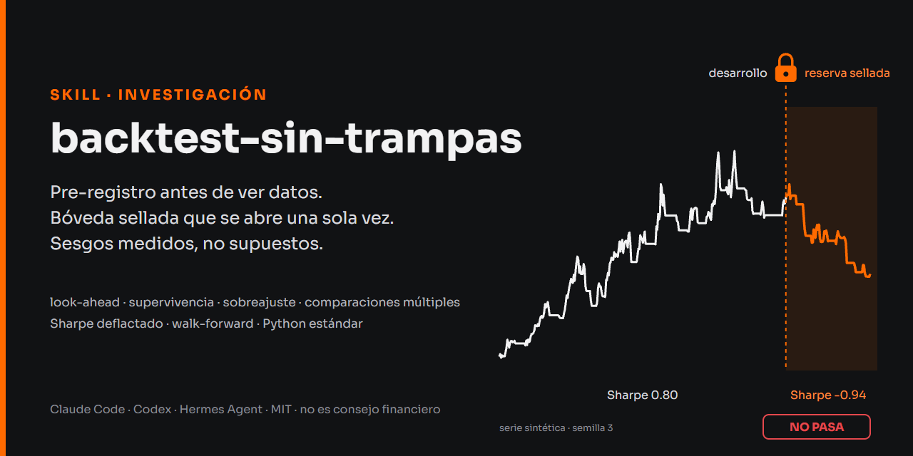
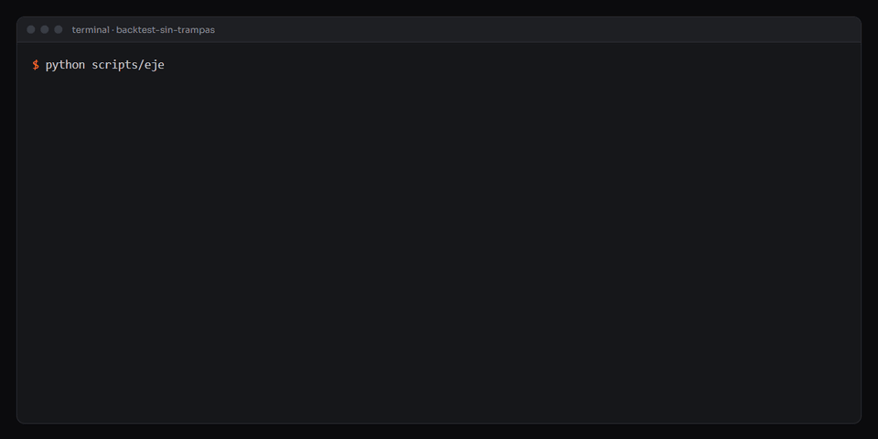
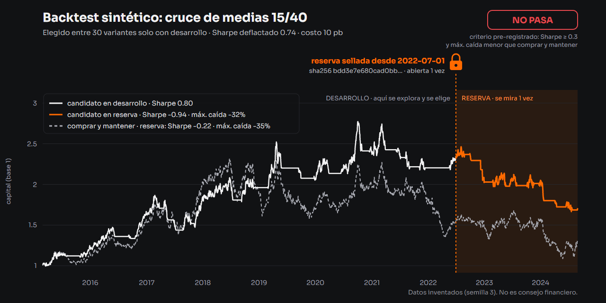
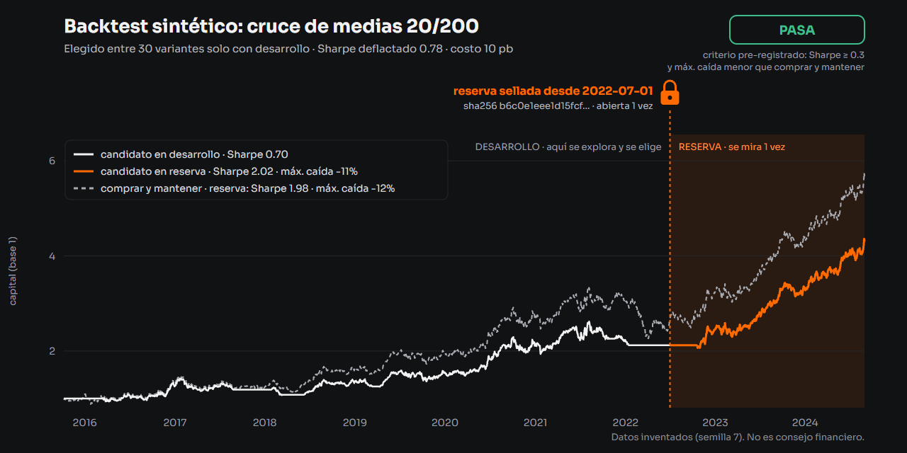

# backtest-sin-trampas

**Investigación de estrategias sistemáticas que no se engaña a sí misma: pre-registro antes de ver datos,
una bóveda sellada que se abre una sola vez y sesgos medidos, no supuestos.**

   



> **No es consejo financiero.** Esta skill enseña a no engañarse con resultados históricos; no recomienda
> ninguna inversión. Todos los datos que trae son sintéticos.

## El problema

Pruebas 30 variantes de una estrategia, te quedas con la mejor y su curva es preciosa. Pero la elegiste
mirando los mismos datos con los que la mides: con suficientes intentos, el azar siempre regala una
ganadora. Y si además la señal usa sin querer el cierre de mañana, el universo solo incluye lo que
sobrevivió o los costos se olvidaron, el backtest no mide la estrategia: mide tus trampas. Un agente de IA
con acceso a los datos lo hace más rápido todavía.

## Qué hace

- **Compuertas que no se saltan**: cuestionario → especificación aprobada → código y pruebas → desarrollo →
  candidato congelado → tramos (walk-forward) → **bóveda** → papel → revisión. Cada aprobación habilita solo
  su paso.
- **Pre-registro con hash**: hipótesis, métrica, umbral, **todas** las variantes y qué hacer si el resultado
  es nulo, congelados antes de explorar.
- **Bóveda sellada** (`scripts/boveda.py`): guarda el tramo reciente comprimido y con SHA-256, y se
  **niega a abrirse** si no hay pre-registro, si el pre-registro o el candidato cambiaron, si el archivo
  fue manipulado o si ya se abrió una vez. Cada intento queda registrado.
- **Motor causal mínimo** (`scripts/backtest.py`): la señal de t se ejecuta en t+1, costos por cambio de
  posición, métricas (Sharpe, máx. caída, CAGR), rejilla completa y **Sharpe deflactado** por número de
  intentos (Bailey y López de Prado).
- **Detector de *look-ahead***: recalcula cada señal con los datos truncados; una regla que mira el cierre
  de mañana se detecta (y su Sharpe > 5 delata la trampa).
- **Datos sintéticos reproducibles** con regímenes, y un universo con quiebras que mide el **sesgo de
  supervivencia** (+111 % vs +74 % con la semilla 7).
- **Guías** de sesgos, validación por tramos, búsquedas de 100-1 000+ reglas con controles ciegos, BH,
  *Reality Check* de White y Holm, auditoría tras cada corrida y notas opcionales para Freqtrade.

## Demo



Mismo método, dos series inventadas. Con la semilla 3, el mejor de 30 candidatos tenía Sharpe 0,80 en
desarrollo y **−0,94** en la reserva: la bóveda evitó dar por buena una estrategia sobreajustada.



Con la semilla 7 el candidato **pasa** el criterio pre-registrado (Sharpe 2,02 y máxima caída −11 % frente
a −12 % de comprar y mantener)… aunque comprar y mantener gana más dinero. El gráfico lo muestra igual.



## Por qué es distinto

| | backtest-sin-trampas | backtesting.py / Backtrader / vectorbt | Optimizadores (p. ej. *hyperopt* de Freqtrade) | Libros de método (López de Prado) |
|---|---|---|---|---|
| Motor de backtest completo | No (mínimo, didáctico) | **Sí** | Sí | — |
| Pre-registro con hash | **Sí** | No | No | Lo recomiendan |
| Reserva que se niega a abrirse antes de tiempo o dos veces | **Sí** | No | No | Lo recomiendan |
| Corrección por número de intentos (Sharpe deflactado) | **Sí** | No de serie | No | Lo definen |
| Detector de *look-ahead* | Sí | No de serie | Freqtrade trae `lookahead-analysis` | — |
| Pensado para que un agente de IA siga las compuertas | **Sí** | No | No | No |

No reemplaza a su motor: lo envuelve con disciplina. Úselo con backtesting.py, vectorbt, Freqtrade o su
propio código; la bóveda y el pre-registro funcionan con cualquier CSV de fecha y valor.

## Instalación

Requisitos: ninguno para el método. Para los scripts, **Python 3** (solo biblioteca estándar; probado con
3.11, 3.12 y 3.14).

**Claude Code** (como plugin):

```text
/plugin marketplace add vector-digital-studios/vector-digital-skills
/plugin install investigacion@vector-digital-skills
```

**Copia manual** (cualquier agente que lea `SKILL.md`):

```bash
git clone https://github.com/vector-digital-studios/vector-digital-skills
cp -r vector-digital-skills/skills/investigacion/backtest-sin-trampas ~/.claude/skills/               # Claude Code
cp -r vector-digital-skills/skills/investigacion/backtest-sin-trampas ~/.codex/skills/                # Codex
cp -r vector-digital-skills/skills/investigacion/backtest-sin-trampas ~/.hermes/skills/investigacion/ # Hermes Agent
```

Comprobar:

```bash
python ~/.claude/skills/backtest-sin-trampas/scripts/autoprueba.py
# … 32 de 32 comprobaciones · OK
```

## Uso

**1. Pedírselo al agente**

```text
Quiero probar un cruce de medias en mi serie diaria. Usa backtest-sin-trampas:
pre-registro primero, sella el último 25 % y no lo abras hasta que congelemos el candidato.
```

El agente pregunta los 10 puntos del cuestionario, redacta el pre-registro, lo congela y sella la reserva
antes de tocar los datos.

**2. Recorrido completo con datos sintéticos**

```bash
python scripts/ejemplo.py demo --semilla 3
```
```text
1. pre-registro congelado          sha256 4123edf43e062d66…
2. reserva sellada                 564 días desde 2022-07-01 · sha256 bdd3e7e680cad0bb…
3. abrir antes de tiempo           RECHAZADO → CANDIDATO_NO_CONGELADO
4. búsqueda en desarrollo          30 variantes · mejor 15/40 · Sharpe 0.80 · deflactado 0.74
   tramos (sin re-optimizar)      T1 Sharpe 1.00 · T2 Sharpe 1.02 · T3 Sharpe 0.32
5. candidato congelado             sha256 c38f3ca458dc9263…
6. bóveda abierta (1.ª y única)    reserva: Sharpe -0.94 · retorno -27.4% · caída -32.4%
   comprar y mantener             Sharpe -0.22 · retorno -15.2% · caída -35.4%
7. criterio pre-registrado         NO PASA
8. segunda apertura                RECHAZADO → YA_ABIERTA
```

**3. La bóveda con sus propios datos** (CSV con columnas `fecha,cierre`)

```bash
python scripts/boveda.py preregistrar trabajo/ preregistro.md
python scripts/boveda.py sellar trabajo/ precios.csv --corte 2022-07-01
python scripts/boveda.py desarrollo trabajo/ > desarrollo.csv
python scripts/backtest.py buscar desarrollo.csv --costo-pb 10
python scripts/boveda.py congelar trabajo/ candidato.json
python scripts/boveda.py abrir trabajo/ > reserva.csv
python scripts/boveda.py abrir trabajo/
# BÓVEDA: YA_ABIERTA: la bóveda ya se abrió el 2026-11-24T08:26:18+00:00   (código de salida 3)
```

## Cómo funciona

```text
SKILL.md                         compuertas, cuestionario, causalidad, riesgo, validación, reproducibilidad
references/pre-registro.md       cuestionario de 10 puntos, plantilla, enmiendas
references/boveda-sellada.md     protocolo; búsquedas de 100-1 000+ reglas; resultado nulo
references/sesgos.md             look-ahead, supervivencia, sobreajuste, múltiples, datos contaminados
references/walk-forward.md       tramos, métricas mínimas, fragilidad, papel
references/auditoria-post-ejecucion.md   lista de control y recuperación tras ejecución prematura
references/notas-freqtrade.md    trampas conocidas (opcional)
scripts/datos_sinteticos.py      serie con regímenes · universo con quiebras
scripts/boveda.py                preregistrar · sellar · desarrollo · congelar · abrir · estado
scripts/backtest.py              cruce de medias causal · métricas · rejilla · Sharpe deflactado · look-ahead
scripts/ejemplo.py               recorrido completo → resultados.json + grafico.svg
scripts/autoprueba.py            32 comprobaciones
```

Códigos de la bóveda: `PREREGISTRO_AUSENTE`, `PREREGISTRO_ALTERADO`, `CANDIDATO_NO_CONGELADO`,
`CANDIDATO_ALTERADO`, `BOVEDA_ALTERADA`, `YA_ABIERTA`, `YA_CONGELADO`, `YA_SELLADA`, `SIN_SELLAR`,
`DESARROLLO_ALTERADO`, `CORTE_INVALIDO`.

## Límites conocidos

- **La bóveda es disciplina, no criptografía.** Quien tenga el archivo puede descomprimirlo a mano; lo que
  la bóveda garantiza es que hacerlo sea un acto deliberado y que cualquier cambio en pre-registro,
  candidato o reserva se detecte por hash. En equipo, guarde la reserva fuera del alcance de quien investiga.
- El motor incluido es **didáctico**: una estrategia (cruce de medias), un activo, solo largo, costo fijo por
  cambio de posición, sin tamaño de posición ni intradía. Para producción, use su motor y aplique el método.
- El chequeo de *look-ahead* muestrea ~40 puntos y detecta dependencia del futuro en la **señal**; no ve
  fugas en la preparación de datos (p. ej. normalizar con estadísticas de toda la serie).
- BH, *Reality Check* de White y Holm están documentados, no implementados.
- Uso medido: 50 usos internos registrados de la versión privada (1.3.0). La versión pública reescribe el método en español y retira los casos de proyectos propios.

## Roadmap

- Implementar BH, *Reality Check* de White y Holm en `backtest.py`.
- Bóveda para varios activos (lista de periodos con hash) y para datos de eventos.
- Adaptadores de ejemplo para backtesting.py y vectorbt.

## Créditos

- **Deflated Sharpe Ratio**: Bailey, D. H. y López de Prado, M. (2014), *The Deflated Sharpe Ratio:
  Correcting for Selection Bias, Backtest Overfitting and Non-Normality*, Journal of Portfolio Management
  40(5). Fórmula implementada a partir del artículo; sin código de terceros.
- **Método**: López de Prado, M. (2018), *Advances in Financial Machine Learning*, Wiley (sobreajuste de
  backtests, validación temporal). Benjamini y Hochberg (1995); White (2000), *A Reality Check for Data
  Snooping*, Econometrica; Holm (1979). Solo citados.
- **Freqtrade** ([freqtrade/freqtrade](https://github.com/freqtrade/freqtrade), GPL-3.0): solo citado en
  `references/notas-freqtrade.md`; no se incluye código suyo.

## Licencia

MIT © Vector Digital Studios. Ver `LICENSE` en la raíz del repositorio.

---

## English

**backtest-sin-trampas** ("backtesting without cheating") is a research method for systematic strategies
that doesn't fool itself: pre-registration before seeing data, a sealed holdout vault that opens exactly
once, and biases measured rather than assumed. **Not financial advice**; all bundled data is synthetic.

**The problem.** Try 30 variants, keep the prettiest curve, measure it on the data you chose it with — luck
always hands you a winner. Add an accidental peek at tomorrow's close, a survivors-only universe or
forgotten costs, and the backtest measures your errors, not your strategy. AI agents do this faster.

**What it does.**
- Hard gates: questionnaire → approved spec → code + tests → development → frozen candidate → walk-forward →
  **vault** → paper → review. Each approval unlocks only its own step.
- Hashed pre-registration (hypothesis, metric, threshold, the full variant grid, what a null result means).
- `scripts/boveda.py`: a sealed holdout (compressed + SHA-256) that **refuses to open** without a frozen
  pre-registration and candidate, if anything was edited or tampered with, or if it was already opened.
  Every attempt is logged.
- `scripts/backtest.py`: causal mini-engine (signal at t, fill at t+1), costs, metrics, full grid,
  **Deflated Sharpe Ratio**, and a look-ahead detector.
- Reproducible synthetic data with regimes and a universe with delistings (survivorship bias:
  +111 % vs +74 % with seed 7).
- Guides on biases, walk-forward, 100–1,000+ rule searches (blind controls, BH, White's Reality Check, Holm),
  post-run audits, optional Freqtrade notes.

**Demo.** With seed 3 the best of 30 candidates had Sharpe 0.80 in development and **−0.94** in the vault →
NO PASA (fails). With seed 7 it passes the pre-registered criterion. `python scripts/ejemplo.py demo --semilla 3`.

**Why it's different.** Backtesting libraries (backtesting.py, Backtrader, vectorbt) and optimizers give
you an engine; none enforces pre-registration or a vault that refuses early or repeated opening. This skill
wraps any engine with that discipline and is written so an AI agent follows the gates.

**Install.** Claude Code: `/plugin marketplace add vector-digital-studios/vector-digital-skills`, then
`/plugin install investigacion@vector-digital-skills`. Or copy `skills/investigacion/backtest-sin-trampas`
to `~/.claude/skills/`, `~/.codex/skills/` or `~/.hermes/skills/investigacion/`. Check:
`python scripts/autoprueba.py` → `32 de 32 comprobaciones · OK`. Python 3, stdlib only.

**Limits.** The vault is discipline, not cryptography; the engine is didactic (one MA-crossover, long-only);
the look-ahead check samples signals and won't catch leakage in data preparation; BH/White/Holm are
documented, not implemented. Internal use: 50 recorded runs of the private version (1.3.0).

**Credits.** Bailey & López de Prado (2014) *The Deflated Sharpe Ratio*; López de Prado (2018) *Advances in
Financial Machine Learning*; Benjamini–Hochberg (1995); White (2000); Holm (1979); Freqtrade (GPL-3.0) cited
only. **License:** MIT © Vector Digital Studios.
