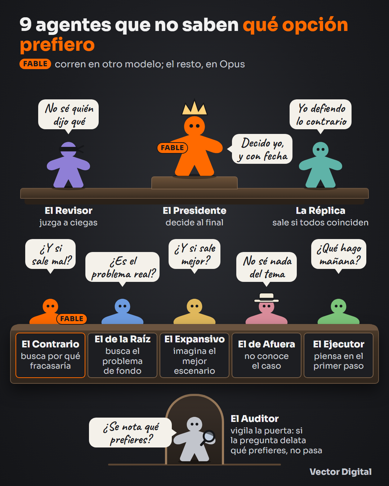
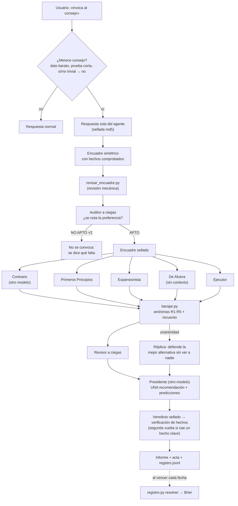

# consejo-decisiones

> **In short (English):** an agent skill that convenes a "council" of AI advisors before a hard decision, to cut
> model sycophancy. A blind auditor checks the framing, five advisors with opposing angles answer independently, a
> blind reviewer and a chair produce ONE recommendation with dated, scorable predictions (Brier score log).



Una skill (procedimiento en Markdown + scripts en Python estándar) para agentes de IA como **Hermes Agent** o
**Claude Code**. Ante una decisión difícil, convoca un «consejo» de papeles con ángulos opuestos y devuelve UNA
recomendación, UN primer paso y predicciones con fecha que luego se puntúan.

## El problema: la complacencia

Un mismo modelo argumenta igual de bien a favor y en contra de casi cualquier cosa. Si le cuentas una decisión
dejando ver hacia dónde te inclinas, tiende a darte la razón; y si el planteamiento ya está torcido (una opción con
más datos, un plazo que deja fuera a otra, una «restricción» que solo afecta a una), la respuesta sale torcida y con
mucha seguridad. Pedirle «sé imparcial» no basta.

El consejo ataca eso en tres frentes:

1. **Antes:** comprueba los hechos del planteamiento y lo audita a ciegas (¿se adivina qué opción prefiere quien lo
   escribió?). Si está desequilibrado, no se convoca.
2. **Durante:** cinco asesores con ángulos impuestos responden sin verse entre sí; se anonimizan y barajan; un
   revisor los juzga a ciegas; si todos coinciden, una réplica independiente defiende la mejor alternativa.
3. **Después:** el presidente deja predicciones con fecha y probabilidad; un registro las resuelve y calcula si el
   consejo acierta (puntuación de Brier) y si aporta algo frente a la respuesta que el agente habría dado solo.

## Cómo funciona



### Los papeles

| Papel | Qué hace | Qué ve |
|---|---|---|
| **Auditor del encuadre** | Intenta adivinar qué opción prefiere quien escribió el planteamiento; busca asimetrías, plazos injustos, restricciones falsas y opciones que faltan. Dictamina APTO / APTO CON CAMBIOS / NO APTO. | Solo el encuadre |
| **El Contrario** | Pre-mortem: da cada opción por elegida y fracasada, y explica por qué. Ataca también la que acaba eligiendo. | El encuadre |
| **Primeros Principios** | Pregunta qué se intenta lograr de verdad y qué supuesto sobra; puede concluir que la pregunta está mal planteada. | El encuadre |
| **El Expansionista** | Busca el escenario alto que nadie ve, dentro de las restricciones y del tiempo real de quien decide. | El encuadre |
| **El de Afuera** | No sabe nada del caso: señala lo que suena raro desde fuera y qué suele pasar en casos parecidos (tasa base). | Una versión genérica del encuadre |
| **El Ejecutor** | Primer paso concreto, cuello de botella y cuándo habrá un dato medible, con el horario real del usuario. | El encuadre |
| **Revisor** | Lee las cinco respuestas anónimas y barajadas: afirmaciones sin respaldo, consenso real, si el acuerdo lo explica el planteamiento, lo que todas omitieron, la respuesta más fuerte. | Encuadre + anónimas + recuento |
| **Réplica** | Solo si hay unanimidad: hace el mejor caso honesto de la alternativa y propone la prueba más barata que decidiría. | Solo el encuadre |
| **Presidente** | Pesa argumentos (no votos) y da UNA recomendación, un primer paso, «si sale mal», 2-3 predicciones con fecha, criterio de corte y los hechos de los que depende. | Su sala: encuadre, respuestas con rol, recuento, revisión, réplica |

Cada papel trabaja aislado en una «sala» (carpeta con solo sus archivos). Los veredictos y el encuadre se sellan con
md5; `sala.py comprobar` verifica sellos, aislamiento y que cada cita del informe aparezca literal en las salidas
crudas.

### Por qué dos papeles en otro modelo

El Contrario y el presidente corren por defecto en un **segundo modelo** (Fable 5.2 a través de la CLI de Claude Code,
con `scripts/fable.py`); el resto, como subagentes del modelo principal (p. ej. Opus). Razón: cinco papeles del mismo
modelo son el mismo actor con cinco disfraces; comparten puntos ciegos, y un modelo que juzga textos propios tiende a
favorecerlos. Otro modelo comparte menos puntos ciegos y no tiene texto propio que defender. Es **diversidad
parcial**: si ambos modelos son del mismo fabricante, parte del sesgo de entrenamiento sigue siendo común.
`--todo-opus` desactiva el segundo modelo.

## Instalación

Requisitos: Python 3.8+ (solo biblioteca estándar). Para el segundo modelo, la CLI de Claude Code instalada y con
sesión iniciada (o `CLAUDE_CODE_OAUTH_TOKEN`).

**Hermes Agent**

```bash
cp -r consejo-decisiones ~/.hermes/skills/<categoría>/consejo-decisiones
```

Los subagentes se lanzan con la herramienta `delegate_task`: los archivos `_tareas_*.json` que genera `sala.py` son
listas `[{"goal", "context"}]` listas para pasarle.

**Claude Code**

```bash
cp -r consejo-decisiones ~/.claude/skills/consejo-decisiones
```

Cada elemento de `_tareas_*.json` se lanza como una tarea de subagente (herramienta Task) con su `context` como
instrucción.

### Configuración (variables de entorno, todas opcionales)

| Variable | Para qué | Defecto |
|---|---|---|
| `CONSEJO_HOME` | Carpeta raíz de los consejos y del `registro.jsonl` | `./consejos` |
| `CONSEJO_REGISTRO` | Ruta exacta del registro (tiene prioridad) | `$CONSEJO_HOME/registro.jsonl` |
| `CONSEJO_HORARIO` | Horario disponible de quien decide (lo usa el Ejecutor) | «no declarado» |
| `FABLE_MODEL` | Modelo del Contrario y del presidente | `claude-fable-5-2` |
| `CLAUDE_CLI` | Ejecutable de la CLI de Claude Code | `claude` / `claude.cmd` del PATH |
| `CLAUDE_CODE_OAUTH_TOKEN` | Token de la CLI | el inicio de sesión normal de la CLI |

## Uso

En la conversación con el agente:

- «**invoca al consejo**: ¿reescribo el backend, lo migro por partes o lo dejo como está?» → modo ligero.
- «**consejo completo**» → tres revisores, réplica siempre y pre-mortem aparte (para dinero real o decisiones
  irreversibles).

El agente sigue `SKILL.md` paso a paso. Comandos sueltos, por si quieres usar los scripts a mano:

```bash
python scripts/revisar_encuadre.py consejos/2026-01-15_backend     # 0 = sin fallas, 3 = hay fallas
python scripts/sala.py sellar consejos/2026-01-15_backend encuadre.md
python scripts/sala.py asesores consejos/2026-01-15_backend        # 4 tareas + _fable_contrario.md
python scripts/fable.py consejos/2026-01-15_backend contrario
python scripts/barajar.py consejos/2026-01-15_backend
python scripts/registro.py resumen
python tests/prueba_basica.py                                       # prueba de los scripts, sin red
```

Hay un encuadre de ejemplo, ficticio y completo, en `templates/ejemplo_encuadre.md`.

## Costos medidos

| Qué | Medida |
|---|---|
| Consejo ligero v0.1 (sin auditor ni réplica) | 7 llamadas, ≈ 10 min de reloj |
| Consejo ligero actual | 8 llamadas (9 con réplica); 12-15 min estimados |
| Contrario en el segundo modelo | ≈ US$0,13 y 32 s por llamada (costo de referencia) |
| Presidente en el segundo modelo | ≈ US$0,26 y 34 s por llamada (costo de referencia) |
| Arranque de la CLI de Claude Code con `--system-prompt` + `--tools ""` | de ~US$0,32 a ~US$0,01 por llamada |

Si tu suscripción cubre la CLI, el «costo de referencia» es lo que reporta la CLI, no un cargo adicional.

## Qué se descartó y por qué

- **Debate entre asesores.** Al leerse entre sí, los modelos ceden hacia la mayoría y pueden cambiar una respuesta
  correcta por una incorrecta (conformidad); el debate entre agentes del mismo modelo no supera de forma fiable a
  uno solo bien planteado. Por eso nadie ve a nadie salvo el revisor y el presidente.
- **Que cada asesor puntúe a los demás** (fase 2 del método original): más llamadas y cada modelo favorece su propio
  texto. Un revisor ajeno es más barato.
- **Probabilidades para los asesores:** no pronostican, exageran un ángulo; las probabilidades se piden solo al
  presidente, sobre hechos medibles.
- **Puntuación numérica por criterios y pesos:** con muchos datos «Desconocido» da una precisión falsa.
- **Que el agente corrija el veredicto:** rompería la separación entre quien plantea y quien decide; para eso está
  la segunda vuelta del presidente.

Detalle completo, rúbrica y las 19 fuentes en [`references/diseno.md`](references/diseno.md).

## Límites honestos

- **Mismo fabricante.** Aunque dos papeles usen otro modelo, si ambos son del mismo fabricante comparten parte del
  entrenamiento y de los puntos ciegos.
- **Nota de diseño 7,8 / 10, autoevaluada.** Mide cuánto cubre el método, no cuánto acierta. El 10 solo se gana con
  el registro de aciertos: ≥ 20 predicciones resueltas con Brier < 0,20 y el consejo mejor que la respuesta sola en
  una parte material de las decisiones.
- La confianza que declaran los modelos tiende a ser alta; por eso se puntúan predicciones con fecha, no la
  confianza.
- El consejo cuesta llamadas y minutos: no sirve para decisiones triviales ni sustituye medir un dato barato.

## Estructura

```
consejo-decisiones/
├── README.md
├── SKILL.md                    procedimiento que sigue el agente
├── LICENSE
├── .gitignore
├── assets/
│   └── consejo.png             imagen del README
├── references/
│   ├── prompts.md              prompts de cada papel y plantillas (los lee sala.py)
│   └── diseno.md               rúbrica, cambios, fuentes y cómo se medirá
├── scripts/
│   ├── revisar_encuadre.py     revisión mecánica del encuadre
│   ├── sala.py                 salas, tareas, sellos md5 y comprobación final
│   ├── barajar.py              anonimiza, baraja y cuenta posturas
│   ├── fable.py                lanza Contrario o presidente en el segundo modelo
│   └── registro.py             predicciones, resoluciones y puntuación de Brier
├── templates/
│   ├── ejemplo_encuadre.md     encuadre ficticio completo
│   └── informe_consejo.md      plantilla Markdown del informe
└── tests/
    └── prueba_basica.py        prueba de los scripts (stdlib, sin red)
```

## Créditos

- Método **LLM Council** de Andrej Karpathy: https://github.com/karpathy/llm-council
- Idea de un solo modelo con cinco lentes: Ole Lehmann.
- Este repositorio es una reescritura propia: no copia el texto de ninguno de los dos.

Autor: Vector Digital

## Licencia

MIT. Ver [LICENSE](LICENSE).
