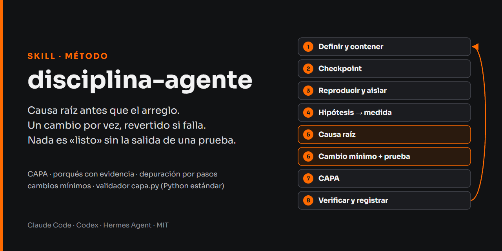
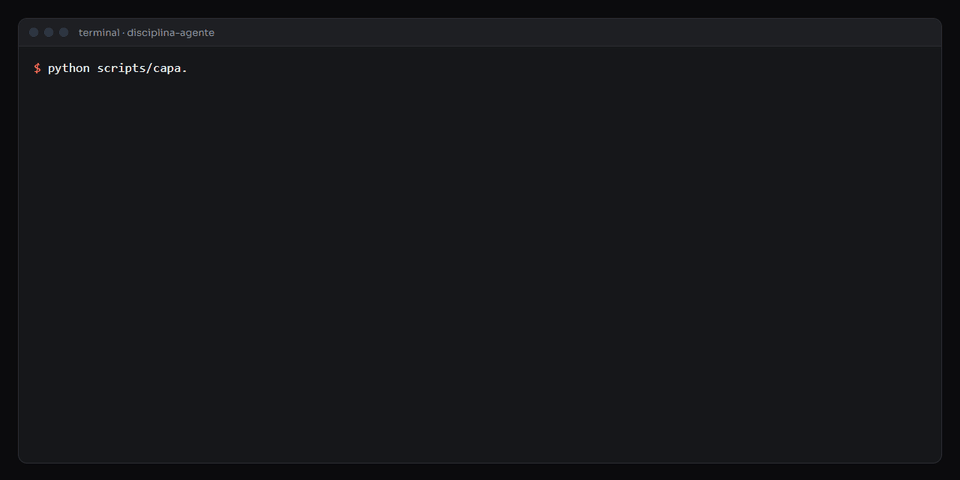
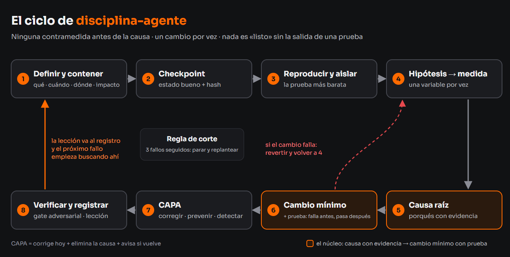

# disciplina-agente

**Que tu agente de programación encuentre la causa antes de arreglar, avance un cambio por vez y no diga
«listo» sin la salida de una prueba.**

   



## El problema

Los agentes de IA arreglan rápido y mal: ven un síntoma, prueban un parche, luego otro encima, y declaran
el problema resuelto porque el error dejó de salir. A la semana vuelve, y nadie sabe cuál de los cinco
cambios hizo qué. Además tienden a «aprovechar» para reformatear y reescribir código que no tocaba, y el
diff de un arreglo de una línea acaba en 400.

## Qué hace

- **Un ciclo de 8 fases** que el agente sigue cuando un fallo se repite o se resiste: definir y contener,
  checkpoint, reproducir y aislar, hipótesis → medida, causa raíz con evidencia, cambio mínimo con
  prueba, CAPA (corregir, prevenir, detectar) y verificar con un gate adversarial.
- **CAPA de verdad** (la práctica de calidad industrial): cinco porqués donde **cada nivel cita evidencia**,
  Ishikawa (6M) para causas múltiples, validación inversa de la cadena, contra-métrica con número y fecha,
  Pareto de recurrencia y una taxonomía de 12 clases de fallo.
- **Depuración por pasos**: un cambio por paso, revertir lo que no funcionó antes de seguir, la prueba
  más barata que discrimine, y **regla de corte**: tras 3 fallos seguidos se para y se replantea.
- **Cambios mínimos**: entender antes de escribir, lo más simple que funcione, diffs quirúrgicos,
  criterio de éxito definido antes de empezar.
- **`scripts/capa.py`**, un validador (solo biblioteca estándar) que rechaza registros de incidente y
  bitácoras de depuración que no cumplen el método: contramedidas sin causa, porqués sin evidencia,
  impacto sin cifra, contra-métricas sin fecha, «PASS» sin verificación, pasos con dos cambios, cambios
  fallidos sin revertir, un cuarto intento a ciegas.

## Demo



El ciclo completo:



## Por qué es distinto

| | disciplina-agente | `systematic-debugging` (obra/superpowers) | Reglas «Karpathy» (CLAUDE.md) | Sin nada |
|---|---|---|---|---|
| Causa raíz antes de arreglar | Sí, con evidencia por nivel | Sí (4 fases) | Indirecto («piensa antes») | No |
| CAPA: preventiva + detección + contra-métrica con fecha | **Sí** | No | No | No |
| Registro de lecciones y control de recurrencia (Pareto) | **Sí** | No | No | No |
| Regla de corte tras 3 fallos | Sí | Sí | No | No |
| Cambios mínimos / diffs quirúrgicos | Sí | Parcial | **Sí, es su foco** | No |
| Validador ejecutable del registro y la bitácora | **Sí (`capa.py`)** | No | No | No |
| Idioma | Español (README también en inglés) | Inglés | Inglés | — |

Superpowers es un marco completo de desarrollo (planificación, TDD, revisión, subagentes) y su skill de
depuración es excelente; esta skill es más estrecha y añade lo que viene de la gestión de calidad: la
acción preventiva, la detección, la contra-métrica y el registro que evita repetir el mismo arreglo
fallido. Se pueden usar juntas.

## Instalación

Requisitos: ninguno para el método. Para el validador, **Python 3** (solo biblioteca estándar;
probado con 3.11, 3.12 y 3.14).

**Claude Code** (como plugin):

```text
/plugin marketplace add vector-digital-studios/vector-digital-skills
/plugin install metodo@vector-digital-skills
```

**Copia manual** (cualquier agente que lea `SKILL.md`):

```bash
git clone https://github.com/vector-digital-studios/vector-digital-skills
cp -r vector-digital-skills/skills/metodo/disciplina-agente ~/.claude/skills/        # Claude Code
cp -r vector-digital-skills/skills/metodo/disciplina-agente ~/.codex/skills/         # Codex
cp -r vector-digital-skills/skills/metodo/disciplina-agente ~/.hermes/skills/metodo/ # Hermes Agent
```

Comprobar la instalación:

```bash
python ~/.claude/skills/disciplina-agente/scripts/autoprueba.py
# … 30 de 30 comprobaciones · OK
```

## Uso

**1. Pedírselo al agente**

```text
Los tests de integración fallan 2 de cada 5 veces en CI. Aplica disciplina-agente:
causa raíz con evidencia antes de tocar nada, un cambio por paso y bitácora.
```

El agente responde con el plan por tramos, crea un checkpoint, escribe hipótesis falsables y anota cada
paso en `bitacora.md` (formato en `templates/bitacora-depuracion.md`).

**2. Validar un registro de incidente**

```bash
python scripts/capa.py validar templates/ejemplo-rechazado.md
```
```text
FALLA AC-008  (0 porqués, 8 errores, 0 avisos)
      ✗ ARREGLO_SIN_CAUSA: hay contramedidas pero falta la causa raíz o la cadena de porqués
      ✗ CAMPO_FALTANTE: Clase
      ✗ CAMPO_FALTANTE: Validación inversa
      ✗ CAMPO_FALTANTE: Detección
      ✗ CAMPO_FALTANTE: Contra-métrica
      ✗ GATE_SIN_VERIFICACION: el gate dice PASS pero no hay verificación con evidencia
      ✗ CAMPO_FALTANTE: Lección
      ✗ IMPACTO_SIN_CIFRA: el impacto necesita una cifra con unidad
1 registro(s) · NO válido
```
(código de salida 1). El registro completo de ejemplo, `templates/registro-capa.md`, da
`OK AC-007 (5 porqués, 0 errores, 0 avisos)` y código 0.

**3. Validar una bitácora de depuración** (también útil como compuerta en CI o en un *hook*)

```bash
python scripts/capa.py bitacora bitacora.md --json
```

Con una bitácora donde se acumulan 4 fallos seguidos, un paso con dos cambios y un cambio fallido sin
revertir, devuelve código 1 con `PASOS_MULTIPLES_CAMBIOS`, `PASO_NO_REVERTIDO`, `MEDIDA_SIN_DATO`,
`CUARTO_INTENTO_A_CIEGAS` y el aviso `CORTE_3_FALLOS` (caso cubierto por la autoprueba).

## Cómo funciona

```text
SKILL.md                      el ciclo de 8 fases, cuándo activarlo y las reglas no negociables
references/capa.md            porqués, Ishikawa, validación inversa, CAPA, Pareto, taxonomía, gate
references/depuracion-por-pasos.md   microobjetivos, checkpoint, prueba más barata, bitácora
references/cambios-minimos.md        entender, simplificar, diff quirúrgico, criterio de éxito
references/higiene-de-datos.md       reglas para cualquier cifra que sostenga una conclusión
templates/                    registro CAPA y bitácora de ejemplo (inventados) + un ejemplo rechazado
scripts/capa.py               nuevo · nuevo-bitacora · validar · bitacora  (salida texto o --json)
scripts/autoprueba.py         30 comprobaciones: coherencia de la skill + casos buenos y malos
```

`capa.py` lee Markdown con campos `- Campo: valor`, una sección `### Porqués` numerada (cada nivel con
`— evidencia: …`) y, en las bitácoras, bloques `### Paso N`. Códigos de salida: `0` válido, `1` con
errores, `2` uso incorrecto o archivo ilegible.

## Límites conocidos

- El validador comprueba **forma, no verdad**: puede verificar que cada porqué cite evidencia, no que la
  evidencia sea correcta. El gate adversarial sigue siendo necesario.
- La detección de «dos cambios en un paso» es heurística (`;`, ` + `, «y además», «y también»).
- La skill guía al agente; no lo obliga. Para forzarlo, use `capa.py` como compuerta (CI o *hook*).
- Uso medido hasta ahora: interno, desde octubre de 2026, en incidentes de pipelines de vídeo, despliegues
  y scripts; pocas activaciones (11 registradas entre las tres skills de origen).

## Roadmap

- Exportar el registro a CSV para el Pareto de recurrencia.
- Plantilla de *hook* para Claude Code que exija bitácora válida antes de cerrar una tarea de depuración.
- Versión en inglés de las referencias.

## Créditos

- **CAPA, cinco porqués, Ishikawa y Pareto** son prácticas de gestión de calidad de dominio público
  (Toyota Production System, K. Ishikawa, ISO 9001); la redacción aquí es propia.
- **Cambios mínimos**: inspirado en las observaciones públicas de Andrej Karpathy sobre fallos típicos de
  los LLM al programar, popularizadas como cuatro principios en
  [multica-ai/andrej-karpathy-skills](https://github.com/multica-ai/andrej-karpathy-skills) (antes
  `forrestchang/andrej-karpathy-skills`; su README declara licencia MIT, aunque el repositorio no incluye
  archivo LICENSE). **No se copió su texto**: la referencia `cambios-minimos.md` es redacción propia.
- Comparado con [obra/superpowers](https://github.com/obra/superpowers) (MIT), skill
  `systematic-debugging`. No se copió nada.

## Licencia

MIT © Vector Digital Studios. Ver `LICENSE` en la raíz del repositorio.

---

## English

**disciplina-agente** makes your coding agent find the root cause before fixing, move one change at a
time, and never say "done" without real test output.

**The problem.** AI agents fix fast and badly: patch on top of patch until the error disappears, then it
comes back a week later and nobody knows which change did what. They also "tidy up" unrelated code, so a
one-line fix becomes a 400-line diff.

**What it does.**
- An 8-phase loop: define & contain, checkpoint, reproduce & isolate, hypothesis → measurement, root cause
  with evidence, minimal change + test, CAPA (correct, prevent, detect), verify with an adversarial gate.
- Real CAPA from quality management: 5 whys where **every level cites evidence**, Ishikawa (6M), reverse
  validation, a counter-metric with a number and a re-measure date, recurrence Pareto, a 12-class failure
  taxonomy.
- Step-by-step debugging: one change per step, revert failures before the next attempt, cheapest
  discriminating test, and a **stop rule** after 3 consecutive failures.
- Minimal changes: understand first, simplest thing that works, surgical diffs, success criteria up front.
- `scripts/capa.py` (stdlib only) rejects incident records and debugging logs that skip the method
  (`ARREGLO_SIN_CAUSA` = fix without cause, evidence-less whys, impact without a number, PASS without
  verification, multi-change steps, unreverted failures, a 4th blind attempt).

**Why it's different.** obra/superpowers' `systematic-debugging` (MIT) is great at root-causing; the
"Karpathy" CLAUDE.md rules focus on minimal diffs. This skill adds the quality-management half —
preventive action, detection, dated counter-metric, lessons log — plus an executable validator. They
combine well.

**Install.** Claude Code: `/plugin marketplace add vector-digital-studios/vector-digital-skills` then
`/plugin install metodo@vector-digital-skills`. Or copy `skills/metodo/disciplina-agente` to
`~/.claude/skills/`, `~/.codex/skills/` or `~/.hermes/skills/metodo/`. Check with
`python scripts/autoprueba.py` → `30 de 30 comprobaciones · OK`.

**Usage.** Ask your agent to "apply disciplina-agente"; validate records with
`python scripts/capa.py validar record.md` and logs with `python scripts/capa.py bitacora log.md`
(exit 0 valid, 1 errors, 2 usage). Field names are in Spanish.

**Limits.** It checks form, not truth; the multi-change heuristic is simple; it guides the agent but
doesn't force it unless you wire `capa.py` into CI or a hook. Internal use since Oct 2026, few runs so far.

**Credits.** CAPA/5 whys/Ishikawa/Pareto are public-domain quality practices; minimal-change rules are
inspired by Andrej Karpathy's public remarks as popularized by multica-ai/andrej-karpathy-skills (README
states MIT; no text copied). Compared with obra/superpowers (MIT). **License:** MIT © Vector Digital Studios.
