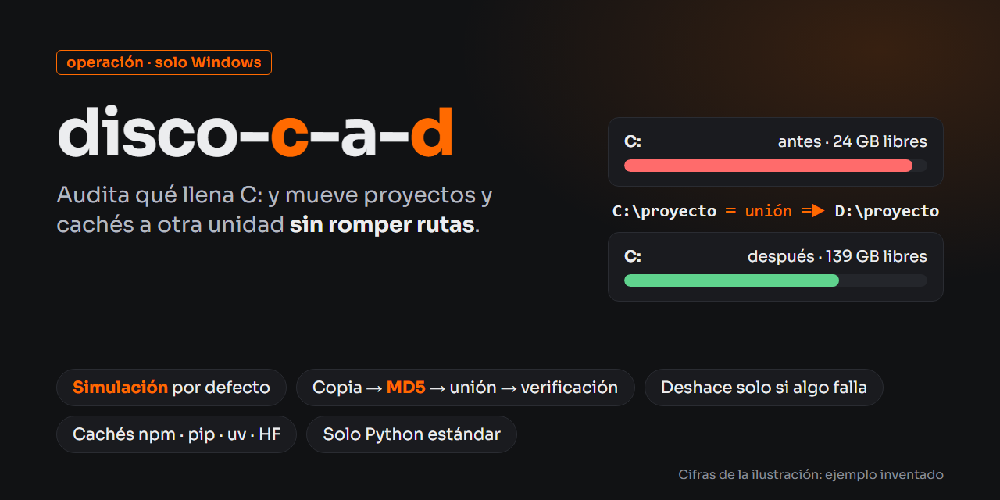
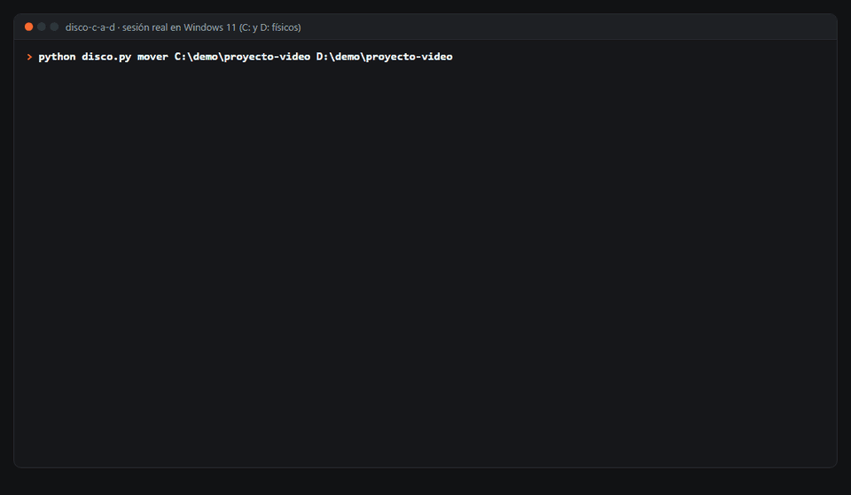
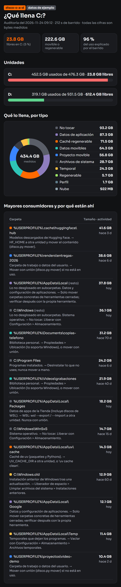
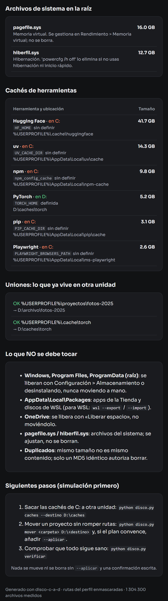

# disco-c-a-d

**Audita qué llena el disco C: y mueve proyectos y cachés a otra unidad sin romper ni una ruta.**

    



> **Solo Windows.** Mover sin romper rutas depende de las uniones NTFS (junctions), `robocopy` y las variables
> de usuario de Windows. La auditoría funciona en cualquier sistema, pero la skill está pensada para Windows.

## El problema

C: es el disco pequeño y rápido; D: es el grande. Pero todo cae en C: por defecto: proyectos, cachés de npm,
pip, uv, modelos de Hugging Face, navegadores de Playwright, temporales. Cuando se llena, las herramientas
gráficas te dicen *qué* ocupa, pero no *por qué está ahí* ni cómo sacarlo sin que fallen los scripts, tareas
programadas y configuraciones que tienen la ruta vieja escrita.

## Qué hace

- **Audita** la unidad entera sin seguir uniones (no cuenta dos veces lo ya movido), mide `pagefile.sys` y
  `hiberfil.sys`, separa lo que está solo en la nube y **cuadra** lo medido con el espacio usado.
- **Explica** cada carpeta grande: qué es, por qué está ahí y qué hacer (caché regenerable, temporal, datos
  movibles, proyecto, app, no tocar).
- **Mueve** una carpeta a otra unidad y deja una **unión** en la ruta original: todo sigue funcionando igual.
  Copia, verifica (recuento + bytes + MD5), crea la unión, **lee a través de ella** y solo entonces borra.
- **Saca las cachés** de 13 herramientas (npm, pip, uv, Hugging Face, PyTorch, Playwright, Yarn, NuGet,
  Gradle, Cargo, Go, conda y, opcional, TEMP) con variables de usuario, sin administrador.
- **Verifica** que las uniones siguen sanas y detecta las rotas. **Revierte** un movimiento si hace falta.
- **Seguro por defecto**: todo en simulación; aplicar exige `--aplicar` y una confirmación escrita; cualquier
  fallo se deshace solo y deja el original intacto.

## Demo

Sesión real en Windows 11 con dos discos físicos (C: y D:): simulación, movimiento verificado, la unión que
queda en C:, verificación y el rechazo de una ruta del sistema.



Informe de auditoría (datos de ejemplo inventados):

| Resumen, reparto y mayores consumidores | Cachés, uniones y lo que no se toca |
|---|---|
|  |  |

## Por qué es distinto

| | disco-c-a-d | WinDirStat / TreeSize Free | Sensor de almacenamiento | `mklink /J` a mano |
|---|---|---|---|---|
| Ver qué ocupa | Sí, **con el porqué** de cada carpeta | Sí, muy visual | No | No |
| Mover sin romper rutas | Sí, verificado y reversible | No | No | Sí, sin verificación ni deshacer |
| Simulación y deshacer automático | Sí | No aplica | No | No |
| Cachés de herramientas de desarrollo e IA | 13, por variable de entorno | No | No | No |
| Uso desde un agente de IA | Sí (SKILL.md) | No | No | Parcial |
| Interfaz | CLI + informe HTML | Gráfica | Gráfica | CLI |

WinDirStat y TreeSize son mejores para explorar visualmente un árbol. disco-c-a-d no los sustituye: añade el
paso que falta, **sacar lo pesado de C: sin romper nada y demostrarlo**.

## Instalación

Requisitos: **Windows 10/11, Python 3.9 o superior** (solo biblioteca estándar; nada que instalar con pip).
No hace falta administrador. PowerShell y Git Bash son opcionales: los comandos funcionan en cualquier terminal.

**Claude Code (marketplace):**
```text
/plugin marketplace add vector-digital-studios/vector-digital-skills
/plugin install operacion@vector-digital-skills
```

**Copia manual** (cualquier agente que lea `SKILL.md`: Claude Code, Codex, Hermes):
```powershell
# Claude Code
Copy-Item -Recurse disco-c-a-d $HOME\.claude\skills\disco-c-a-d
# Codex
Copy-Item -Recurse disco-c-a-d $HOME\.codex\skills\disco-c-a-d
# Hermes Agent
Copy-Item -Recurse disco-c-a-d $HOME\.hermes\skills\operacion\disco-c-a-d
```

**Sin agente**: los scripts funcionan solos. Comprueba la instalación con
`python scripts/autoprueba.py` → `OK: 57/57 comprobaciones`.

## Uso

Con un agente, pide en lenguaje natural: *«mi C: está casi lleno, audítalo y dime qué puedo sacar sin romper
nada»*, *«mueve este proyecto a D: sin romper rutas»*, *«saca las cachés de npm, pip y Hugging Face de C:»*.
El agente sigue `SKILL.md`: simula, te enseña el plan y solo aplica cuando dices que sí.

Desde la terminal (salidas reales de la demo):

**1. Auditar** (solo lectura). Aquí sobre `C:\demo`, que tras mover ya solo contiene la unión: no se cuenta dos
veces lo que vive en D:
```text
> python scripts/disco.py auditar --raiz C:\demo --out D:\demo\auditoria.json --html D:\demo\informe.html
Midiendo C:\demo (profundidad 4)…
C: libre: 104.81 GiB · medidos 0.0 GiB en 0 archivos · 1 uniones/enlaces no seguidos · 0 sin permiso · 0.0 s
JSON: D:\demo\auditoria.json
Informe: D:\demo\informe.html
```
Sin `--raiz` recorre la unidad del sistema completa y añade el reparto por categoría y las cachés.

**2. Mover con unión** (primero simulación, luego aplicar):
```text
> python scripts/disco.py mover C:\demo\proyecto-video D:\demo\proyecto-video --aplicar --si
OK 1. copia con robocopy (código 1)
OK 2. verificación: 39 archivos y 276824075 bytes iguales; MD5 idéntico en 39
OK 3. original renombrado
OK 4-5. unión creada y verificada (39 archivos visibles por la ruta antigua)
OK 6. original borrado
RESULTADO: ok · espacio liberado en origen: 263.2 MiB · registro: D:\demo\registro.jsonl

> dir C:\demo
24/11/2026  01:56    <JUNCTION>     proyecto-video [D:\demo\proyecto-video]
```

**3. Cachés fuera de C:** (simulación):
```text
> python scripts/disco.py caches --destino D:\caches --solo npm,pip,uv,hf --sin-medir
herramienta           variable                  ahora         tamaño  propuesto
npm                   npm_config_cache          C:                 —  D:\caches\npm-cache
pip                   PIP_CACHE_DIR             C:                 —  D:\caches\pip-cache
…
SIMULACIÓN. Equivalente manual (variables de USUARIO, sin administrador):
  setx npm_config_cache "D:\caches\npm-cache"
```

**4. Verificar y, si hace falta, revertir:**
```text
> python scripts/disco.py verificar
OK    C:\demo\proyecto-video
      -> D:\demo\proyecto-video: 39 archivos visibles (registrados al mover: 39)
1/1 correctos
> python scripts/disco.py revertir C:\demo\proyecto-video --aplicar
```

## Cómo funciona

```text
auditar  ─ os.scandir en un solo recorrido ─ no sigue uniones (etiqueta de reanálisis) ─ suma por categoría
         ─ pagefile/hiberfil aparte ─ cuadre con disk_usage ─ JSON ─ informe HTML (sin CDN, sin JS)

mover    validar ─ probar bloqueo ─ copiar (robocopy /E /COPY:DAT /XJ, o copytree si hay symlinks)
         ─ verificar (archivos + bytes + MD5) ─ renombrar original a *.__migrando ─ unión (CreateJunction)
         ─ leer a través de la unión ─ borrar original ─ registro.jsonl
         └─ cualquier fallo antes de borrar: quitar unión + restaurar nombre + limpiar copia parcial
```

| Archivo | Qué hace |
|---|---|
| `scripts/disco.py` | CLI: `auditar`, `informe`, `mover`, `revertir`, `caches`, `verificar` |
| `scripts/disco_core.py` | Medición, clasificación, uniones, mover/revertir, cachés |
| `scripts/disco_informe.py` | Informe HTML |
| `scripts/autoprueba.py` | 57 comprobaciones reales (sin red, sin admin) |
| `scripts/generar_ejemplo.py` | Regenera `templates/auditoria_ejemplo.json` (datos inventados) |
| `references/` | Cómo medir bien en Windows; qué mover y cómo |

**Configuración**: no hay archivo de configuración. Opciones por argumentos; registro en
`%LOCALAPPDATA%\disco-c-a-d\registro.jsonl` (cámbialo con `--registro` o la variable `DISCO_REGISTRO`).

## Límites conocidos

- **Solo Windows** para mover, revertir y fijar variables. La auditoría también corre en otros sistemas.
- Sin administrador, la auditoría no puede leer algunas carpetas del sistema: el informe lo indica con el cuadre.
- Un disco entero de ~1,7 millones de archivos tardó 30 min en la primera pasada y 5 min en la segunda (caché
  del sistema caliente) en un portátil con SSD NVMe; usa `--raiz` para una carpeta concreta.
- Sin administrador, ~9 % del espacio usado quedó sin explicar en esa misma prueba (carpetas sin permiso,
  instantáneas, metadatos NTFS); el informe lo muestra como «cuadre».
- Enlaces simbólicos **dentro** de la carpeta a mover (p. ej. cachés de Hugging Face) exigen modo desarrollador
  o administrador para recrearse; sin eso, el movimiento falla y se deshace solo. La prueba automática de ese
  caso se omite si el usuario no puede crear symlinks.
- Las uniones solo enlazan carpetas **locales**: no sirven para unidades de red.
- `caches` no migra el contenido viejo: la herramienta vuelve a descargar o lo mueves con `mover`.

## Roadmap

- Modo `--paralelo` para auditar unidades grandes más rápido.
- Detección de duplicados por MD5 entre unidades.
- Informe comparativo «antes / después» de una migración.

## Créditos

Desarrollada por **Vector Digital** a partir de su propia auditoría y migración de un equipo de trabajo con
proyectos de video e IA local. Fuente tipográfica de las imágenes: Sora (SIL Open Font License). No incluye
código de terceros.

## Licencia

MIT. Úsala bajo tu responsabilidad: la herramienta no borra nada sin confirmación, pero revisa siempre el plan.

---

## English

**Audit what fills your C: drive and move projects and caches to another drive without breaking a single path.**
Windows only (NTFS junctions, `robocopy`, user environment variables). Python 3.9+, standard library only, no
admin rights needed.

**The problem.** Everything lands on C: by default — projects, npm/pip/uv caches, Hugging Face models, Playwright
browsers, temp files. Disk-usage viewers show *what* is big, not *why it is there* or how to move it without
breaking the scripts, scheduled tasks and configs that have the old path hard-coded.

**What it does.**
- `auditar`: single-pass scan that never follows junctions, measures `pagefile.sys`/`hiberfil.sys`, separates
  cloud-only files, classifies every byte (cache, temp, regenerable, data, project, app, do-not-touch) and checks
  the total against the used space. Outputs JSON and a self-contained mobile-first HTML report.
- `mover`: copies, verifies (file count + bytes + MD5), renames the original, creates a junction at the old path,
  reads through it and only then deletes the original. Any failure rolls everything back.
- `caches`: points 13 tools (npm, pip, uv, Hugging Face, PyTorch, Playwright, Yarn, NuGet, Gradle, Cargo, Go,
  conda, optional TEMP) to another drive via user variables.
- `verificar` / `revertir`: health-check junctions (including broken ones) and undo a move.
- **Dry run by default**; applying needs `--aplicar` plus a typed confirmation. Protected paths (Windows,
  Program Files, profile root, whole AppData, Store apps/WSL, OneDrive) are refused.

**Install.** Claude Code: `/plugin marketplace add vector-digital-studios/vector-digital-skills` then
`/plugin install operacion@vector-digital-skills`. Or copy the folder to `~/.claude/skills/`, `~/.codex/skills/`
or `~/.hermes/skills/operacion/`. Check with `python scripts/autoprueba.py` → `OK: 57/57`.

**Proven in production.** Born from a real audit and migration (Oct–Nov 2026): 25 folders, 7.2 GB and ~23,000
files moved from C: to D: behind junctions with zero failures. Then validated against a real 476 GiB system drive (1.67 M files): 91 % of used space explained without admin rights; full scan 30 min cold, 5 min warm.

**Known limits.** Moving is Windows-only; non-admin scans cannot read some system folders (reported via the
coverage figure); symlinks inside a folder need Developer Mode or admin to be recreated (otherwise the move is
rolled back); junctions only work for local folders; `caches` does not migrate old cache content.

**License.** MIT.
