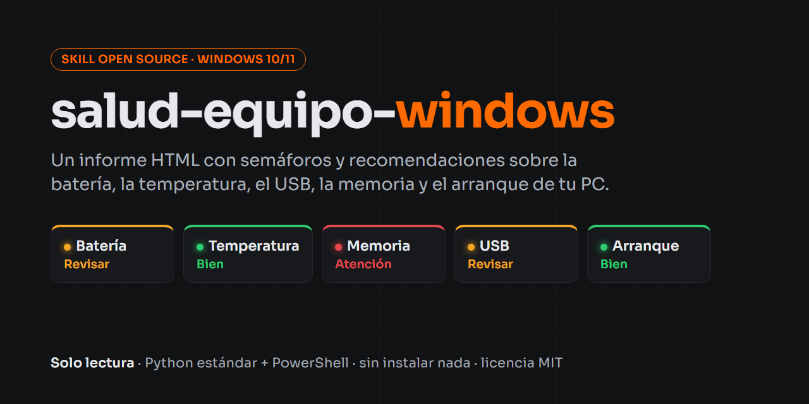
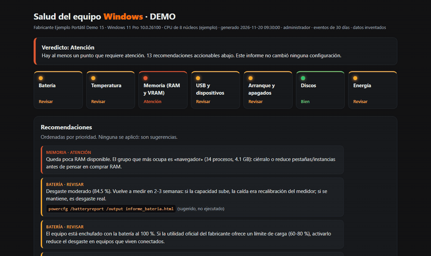
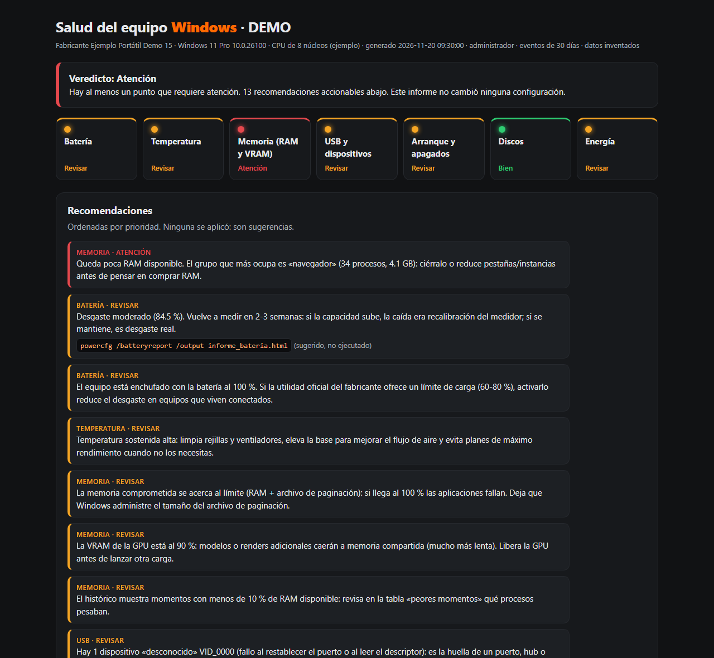
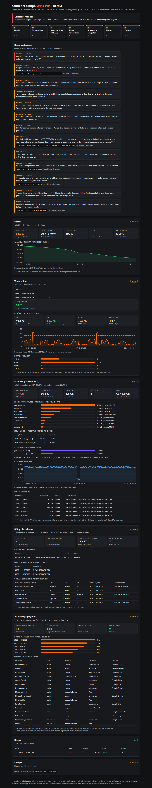
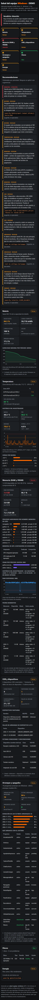

# salud-equipo-windows

**Un comando, un HTML: el estado real de la batería, la temperatura, el USB, la memoria y el
arranque de tu PC con Windows, con semáforos y recomendaciones. No instala nada ni cambia nada.**




> **Solo Windows (10/11).** Lee datos que solo existen en Windows: CIM/WMI, el registro de eventos,
> `powercfg /batteryreport`, el árbol Plug and Play y las claves de inicio del registro. El modo
> `--demo` y la autoprueba sí funcionan en cualquier sistema con Python.

## El problema

Cuando un portátil «va mal», el diagnóstico suele empezar por intuiciones: «se calienta», «le falta
RAM», «el hub está roto». Los datos para comprobarlo existen, pero están repartidos en cinco
herramientas de Windows, unas cuantas exigen administrador y algunas mienten en silencio. Sin
privilegios, la temperatura sale vacía en vez de dar error. El contador de ciclos dice 0 aunque la
batería tenga uso. Un evento de «espera moderna» parece un apagón. Así se acaba comprando un hub
nuevo cuando el problema era la energía del puerto.

## Qué hace

- **Batería**: salud (SOH) frente al diseño, curva de capacidad del `battery-report`, carga actual y
  si vive enchufada al 100 %.
- **Temperatura**: zonas ACPI (con administrador), GPU con `nvidia-smi` si existe, e histórico
  opcional con horas por banda y huecos.
- **USB y dispositivos**: fantasmas `VID_0000`, fallos de inicio (Kernel-PnP 411), conexiones fugaces
  (< 60 s), sobrecorrientes y últimas conexiones y desconexiones con el nombre real del bus.
- **Memoria**: RAM disponible y comprometida, procesos agrupados por nombre, VRAM por adaptador
  (contadores de Windows) y por proceso (`nvidia-smi`). Histórico opcional con los «peores momentos».
- **Arranque y apagados**: qué arranca con Windows (Run, carpeta Inicio, apps de la Tienda), duración
  de los últimos arranques (con administrador), apagados sucios (41), WHEA, espera moderna e inicio
  rápido.
- **Discos y energía**: salud de los discos y plan de energía activo.
- **Recomendaciones ordenadas por prioridad**, cada una con su comando marcado como «sugerido, no
  ejecutado».
- **Muestreadores opcionales** para lo intermitente: temperatura cada 10 min, memoria cada minuto en
  modo intenso, y un monitor que registra en vivo las conexiones y desconexiones USB.

## Demo



Informe real generado con `python scripts/informe_salud.py --demo` (datos inventados):



<details><summary>Informe completo (escritorio) y vista móvil</summary>





</details>

## Por qué es distinto

| | salud-equipo-windows | HWiNFO / HWMonitor | Administrador de tareas / Monitor de rendimiento | `powercfg` y Visor de eventos a mano |
|---|---|---|---|---|
| Instalación | Ninguna (Python + PowerShell del sistema) | Programa con controlador propio | Incluido en Windows | Incluido en Windows |
| Temperatura por núcleo | **No** (solo zona ACPI y GPU NVIDIA) | **Sí**, su punto fuerte | No | No |
| Salud de batería con curva histórica | Sí | Parcial (estado actual) | No | Sí, en un HTML aparte y sin interpretar |
| Fantasmas USB, conexiones fugaces, Kernel-PnP | Sí | No | No | Sí, buscando evento a evento |
| Qué arranca y cuánto tarda el arranque | Sí | No | Lista de inicio (sin duración) | Sí, en el evento 100 |
| Veredicto, semáforos y recomendaciones | **Sí** | No (muestra datos en bruto) | No | No |
| Informe para guardar o compartir | HTML autocontenido | Exporta CSV o informe | No | No |
| Lo usa un agente de IA | Sí (`SKILL.md` + CLI) | No | No | A medias |
| Cambia configuración | **Nunca** | No | Puede desactivar arranques | Sí, si lo pides |

Para monitorizar sensores en vivo, HWiNFO es mejor y lo decimos sin rodeos. Esta skill sirve para
otra cosa: **diagnosticar** con evidencia y dejar un informe legible.

## Instalación

**Claude Code (marketplace del repo):**

```
/plugin marketplace add vector-digital-studios/vector-digital-skills
/plugin install operacion@vector-digital-skills
```

**Copia manual** (desde la carpeta `skills/operacion/` del repo):

```bash
cp -r salud-equipo-windows ~/.claude/skills/                # Claude Code
cp -r salud-equipo-windows ~/.codex/skills/                 # Codex
cp -r salud-equipo-windows ~/.hermes/skills/operacion/      # Hermes Agent
```

En PowerShell: `Copy-Item -Recurse salud-equipo-windows "$env:USERPROFILE\.claude\skills\"`.

Para comprobar la instalación: `python scripts/autoprueba.py` → `autoprueba: 26/26 OK`.

## Uso

**1. Pídeselo al agente**

> «Carga salud-equipo-windows, genera el informe de este equipo y dime qué arreglar primero.»

El agente ejecuta el CLI, abre el HTML y responde empezando por el veredicto.

**2. Demo, sin tocar el sistema** (salida real):

```text
$ python scripts/informe_salud.py --demo
Veredicto: Atención
  [  Revisar] Batería: Salud 84.5 % de la capacidad de diseño
  [  Revisar] Temperatura: Zona térmica ACPI más alta: 71.5 °C · GPU 63 °C
  [ Atención] Memoria (RAM y VRAM): 1.4 GB disponibles de 16.0 GB (9 %) · memoria comprometida 86 %
  [  Revisar] USB y dispositivos: 4 dispositivos USB conectados · 1 fantasma · 2 fallos de inicio de dispositivo · 0 sobrecorrientes
  [  Revisar] Arranque y apagados: 14 programas arrancan con Windows · último arranque medido 84 s
  [     Bien] Discos: 1 disco · 0 con problemas
  [  Revisar] Energía: Plan activo: Alto rendimiento
Recomendaciones accionables: 13
Informe: ...\informe_salud_demo.html
```

**3. Tu equipo, con histórico de temperatura** (salida real del análisis del CSV de ejemplo):

```text
$ python scripts/informe_salud.py --salida informes --temperaturas temps.csv
$ python scripts/analizar_muestras.py temperatura templates/ejemplos/temps-ejemplo.csv
TEMPERATURA · 7 muestras · 2026-11-01 09:00 → 2026-11-02 10:00 · cadencia 15 min
  media 51.6 °C · mediana 47.3 · p95 69.0 · máx 72.4 (01/11 09:50) · mín 41.1
  horas por banda: <45 °C 0.8 h · 45-59 °C 0.5 h · 60-69 °C 0.2 h · ≥70 °C 0.2 h
  huecos > 30 min: 2 (mayor 20.2 h)
```

Sin administrador, el informe lo dice en vez de inventar. Así salieron dos líneas en un portátil
real con Windows 11:

```text
  [     Bien] Temperatura: Sin lectura ACPI (requiere ejecutar como administrador) · GPU 49 °C
  [  Revisar] Arranque y apagados: 18 programas arrancan con Windows · duración del arranque: requiere administrador
```

## Cómo funciona

```
informe_salud.py ──► recolectar.ps1 (PowerShell, solo lectura) ──► JSON temporal
        │             CIM/WMI · Get-WinEvent filtrado · Get-PnpDevice · registro de inicio
        ├──► powercfg /batteryreport (carpeta temporal, se borra) ──► parse_battery_report
        ├──► nvidia-smi (si existe; --sin-nvidia para no despertar la GPU)
        ├──► CSV opcionales de los muestreadores (--temperaturas / --memoria)
        ▼
   salud_lib.evaluar()  →  umbrales + semáforos + recomendaciones
        ▼
   salud_lib.render_html()  →  un .html (CSS inline, gráficos SVG inline, sin JS ni CDN)
```

Umbrales principales:

| Medida | Bien | Revisar | Atención |
|---|---|---|---|
| Batería (SOH) | ≥ 90 % | 80-90 % | < 80 % |
| Temperatura ACPI o p95 | < 70 °C | 70-85 °C | ≥ 85 °C |
| RAM disponible | ≥ 25 % | 10-25 % | < 10 % |
| Memoria comprometida | < 80 % | 80-90 % | ≥ 90 % |
| Último arranque | < 60 s | 60-120 s | ≥ 120 s |
| Programas de inicio activos | ≤ 10 | 11-20 | > 20 |

La explicación de cada uno está en `references/`.

## Configuración

| Opción | Por defecto | Qué hace |
|---|---|---|
| `--salida DIR` | carpeta actual | dónde escribir el HTML |
| `--nombre X.html` | `informe_salud_AAAAMMDD_HHMM.html` | nombre del archivo |
| `--dias N` | 30 | ventana de eventos (apagados, PnP, WHEA) |
| `--temperaturas CSV` | — | añade el histórico del muestreador de temperatura |
| `--memoria DIR` | — | añade el histórico del muestreador de memoria |
| `--sin-nvidia` | — | no llama a `nvidia-smi` |
| `--json` | — | guarda también los datos en bruto |
| `--demo` | — | datos inventados; no toca el sistema |

Para programar los muestreadores, consulta `references/muestreadores.md` (tareas programadas,
ventana oculta y cómo evitar que caduquen).

## Requisitos

- Windows 10 u 11, PowerShell 5.1 o superior (viene con Windows) y Python 3.10 o superior. **Sin
  dependencias externas.**
- **Lecturas que requieren administrador**: temperatura ACPI (`MSAcpi_ThermalZoneTemperature`) y
  duración del arranque (`Diagnostics-Performance`, evento 100). Todo lo demás funciona sin
  privilegios, incluidos el battery-report, la memoria, el USB, la lista de inicio y los apagados.
- `nvidia-smi` es opcional (solo GPU NVIDIA).

## Límites conocidos

- **La temperatura depende del firmware.** Muchos portátiles no exponen zonas ACPI útiles, y la zona
  mide chasis o SoC, no cada núcleo. Para leer por núcleo hace falta HWiNFO o LibreHardwareMonitor.
- Las GPU que no son de NVIDIA muestran la memoria (contadores de Windows) pero no la temperatura.
  En portátiles con controlador WDDM, `nvidia-smi` devuelve `[N/A]` por proceso; en ese caso la
  memoria de GPU por proceso sale de los contadores de Windows.
- Es una **foto del momento**. Lo intermitente necesita los muestreadores.
- La lista de inicio no incluye **tareas programadas ni servicios**.
- La salud de disco es el `HealthStatus` de Windows, no un SMART detallado.
- Probado en Windows 11 con PowerShell 5.1 y Python 3.14, sin administrador. **No se ha probado** en
  Windows 10, en PowerShell 7 ni como administrador (las rutas de código existen, pero no se han
  ejecutado elevadas).
- El battery-report se parsea por sus etiquetas en inglés, que es como lo emite Windows en los
  idiomas probados.

## Roadmap

- Tareas programadas y servicios en la sección de arranque.
- Comparar dos informes (antes y después de un cambio).
- Temperatura de GPU AMD e Intel cuando haya una vía estándar.
- Informe también en inglés.

## Uso real

Nace de dos skills internas de diagnóstico usadas **39 y 21 veces** en un portátil de trabajo, y de un
muestreador de memoria que corre **cada minuto desde noviembre de 2026** (unos 9 MB de CSV al mes).
Las lecciones de esas sesiones están en `references/`: la tarea programada que caducaba en silencio,
el `.ps1` con tildes que dejaba secciones vacías, los dos hubs que fallaban igual y los 506 que no
eran apagones.

## Créditos

- Código y documentación propios de Vector Digital (MIT). No incluye código de terceros.
- Referencias técnicas: documentación pública de Microsoft sobre `powercfg`, CIM/WMI, el registro de
  eventos y los eventos Kernel-Power, Kernel-PnP y Diagnostics-Performance.
- Portada compuesta con la tipografía **Sora** (SIL Open Font License 1.1). La fuente no se incluye.
- Insignias de [shields.io](https://shields.io).

## Licencia

MIT. Ver `LICENSE` en la raíz del repositorio.

---

## English

**salud-equipo-windows**: one command, one self-contained HTML report on the real state of a
Windows PC's battery, temperature, USB devices, memory and startup, with traffic-light verdicts and
prioritised recommendations. **Read-only**: it never changes system settings, and every suggested
action is shown as a command marked "suggested, not executed".

**Windows 10/11 only**, because it reads Windows-only sources: CIM/WMI, the event log,
`powercfg /batteryreport`, the Plug and Play tree and the startup registry keys. `--demo` and the
self-test run anywhere Python 3.10+ runs.

**What it covers**

- **Battery**: health (SOH) against design capacity and the capacity curve.
- **Temperature**: ACPI zones (admin) and NVIDIA GPU, plus an optional history with hours per band
  and gaps.
- **USB**: `VID_0000` phantom devices, Kernel-PnP 411 failures, sub-60-second connects and over-current
  events.
- **Memory**: RAM and commit charge, processes grouped by name, and VRAM per adapter and per process.
- **Startup**: Run keys, Startup folder and Store apps; boot duration (admin); dirty shutdowns (41),
  WHEA and modern standby.
- **Disks and power plan.**

**Install**: `/plugin marketplace add vector-digital-studios/vector-digital-skills` then
`/plugin install operacion@vector-digital-skills`, or copy the folder to `~/.claude/skills/`,
`~/.codex/skills/` or `~/.hermes/skills/operacion/`.

**Use**:

- `python scripts/informe_salud.py [--salida DIR] [--temperaturas temps.csv] [--memoria DIR]`
- `python scripts/informe_salud.py --demo` for invented data.
- `python scripts/autoprueba.py` runs 26 offline tests and must end with `26/26 OK`.

**Requirements**: Windows 10/11, PowerShell 5.1+ and Python 3.10+, with no third-party packages.
ACPI temperature and boot duration need an elevated console; everything else works without it.

**Compared to alternatives**: HWiNFO/HWMonitor are better for live per-core sensors. This tool does
not replace them. It turns scattered Windows data into a verdict, evidence and a shareable report
that an AI agent can produce and explain.

**Limits**:

- Temperature depends on the firmware (chassis/SoC zone, not per-core).
- Non-NVIDIA GPUs get memory but no temperature.
- It is a snapshot unless you add the optional samplers.
- Scheduled tasks and services are not yet listed at startup.
- Tested on Windows 11 / PowerShell 5.1 without admin only.

**Production use**: it grew out of two internal diagnostic skills used 39 and 21 times, and a
memory sampler running every minute since Nov 2026.

**License**: MIT.
