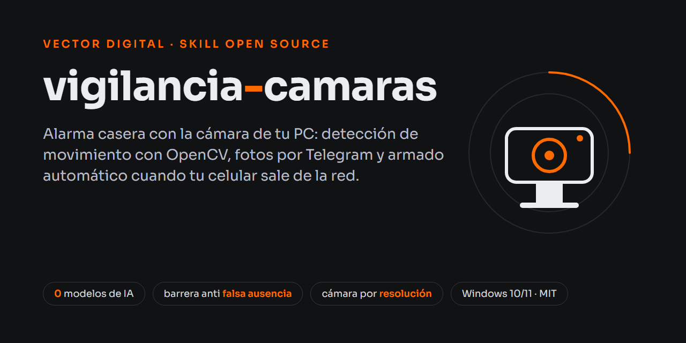
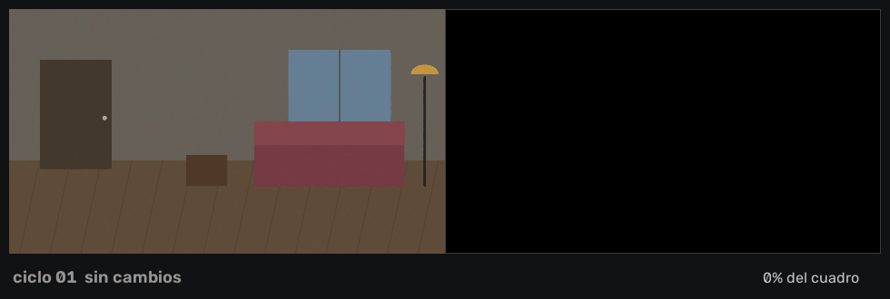
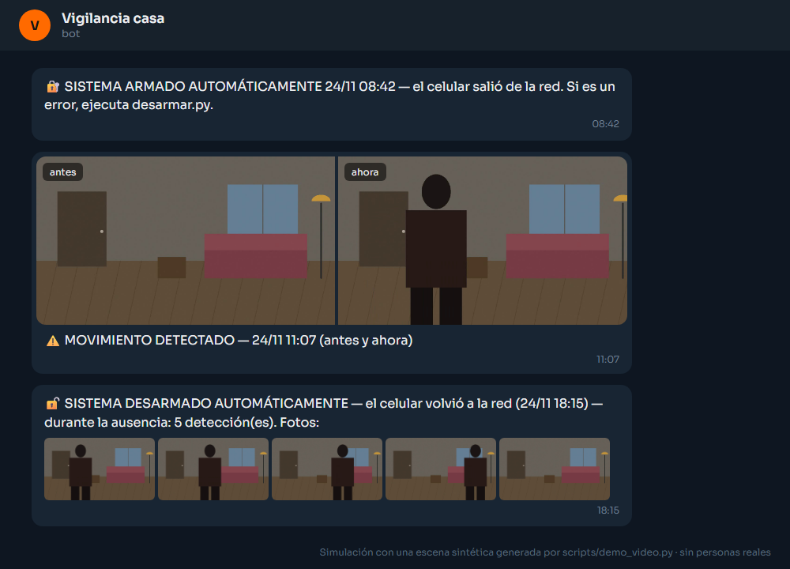
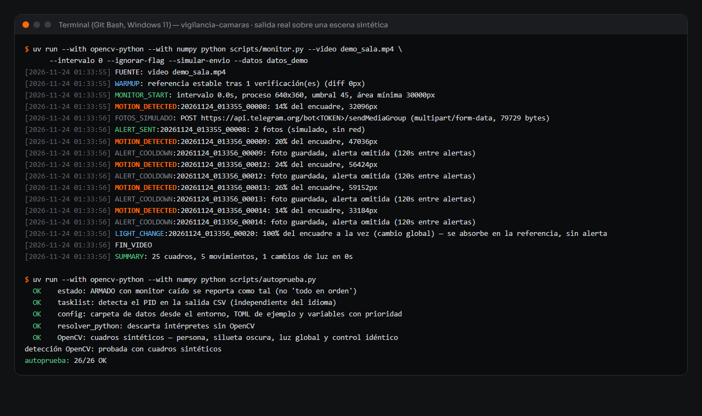
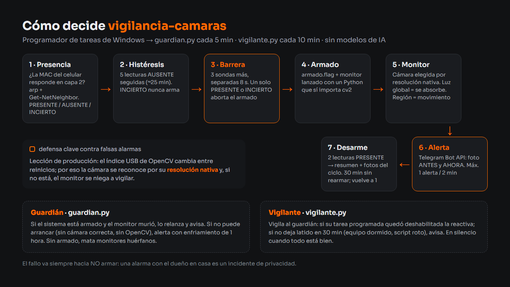

# vigilancia-camaras

**Convierte la webcam de tu PC con Windows en una alarma que se arma sola cuando sales de casa y te
manda la foto por Telegram: sin nube, sin suscripción y sin modelos de IA.**

   

> **Solo Windows 10/11.** Usa piezas propias de Windows: la tabla `arp -a` y `Get-NetNeighbor` para saber
> si tu celular está en la red, los backends de cámara DirectShow/Media Foundation de OpenCV, el
> Programador de tareas (`schtasks`) y `tasklist`/`taskkill` para vigilar procesos. La lógica es Python
> puro y se podría portar, pero hoy solo está probada en Windows.



## El problema

Las alarmas caseras con cámara suelen pedir una de tres cosas: pagar una nube, montar un servidor NVR con
Docker o acordarte de armarla cada vez que sales. Y las que se arman solas por el celular fallan de la
forma más molesta: el teléfono entra en ahorro de energía, deja de responder unos minutos y la alarma
se arma **contigo dentro de casa**. Una alarma que manda fotos falsas acaba ignorada.

## Qué hace

- **Detecta movimiento con OpenCV, sin IA**: compara cada cuadro con una referencia y distingue un
  cambio de luz (casi todo el cuadro cambia a la vez) de una persona (cambia una región).
- **Te manda dos fotos por Telegram**: *antes* y *ahora*, con un máximo de una alerta cada 2 minutos.
  Guarda además un **mapa de píxeles cambiados** (`mapa_*.jpg`) que no envía salvo que se lo pidas.
- **Se arma sola cuando tu celular sale de la red** y se desarma cuando vuelve, decidiendo en capa 2
  (ARP / vecinos de red), no por ping: un celular dormido no responde ping pero sigue en el WiFi.
- **Barrera anti falsa ausencia**: antes de armar repite la sonda varias veces; una sola lectura de
  "presente" o "dudoso" cancela el armado.
- **Elige la cámara por su resolución nativa**, porque el índice USB de OpenCV cambia entre reinicios.
  Si la cámara correcta no está, **se niega a vigilar** y te avisa.
- **Se cuida sola**: un guardián relanza el monitor si muere y un vigilante revisa que el guardián siga
  programado y corriendo.

## Demo



*Escena sintética generada con `scripts/demo_video.py` y procesada por la misma lógica del monitor: una
silueta entra y sale (MOVIMIENTO) y luego se enciende una lámpara (LUZ: se absorbe, sin alerta).*

| Así llega la alerta (simulada) | Salida real del monitor |
|---|---|
|  |  |

## Por qué es distinto

| | **vigilancia-camaras** | Frigate | motionEye | ZoneMinder | Agent DVR |
|---|---|---|---|---|---|
| Qué es | Skill + scripts para una webcam del PC | NVR con detección de objetos por IA | Interfaz web para Motion | NVR completo | NVR/DVR multiplataforma |
| Instalación | Python + `opencv-python` | Docker; acelerador (Coral/GPU) recomendado | Linux / Raspberry Pi | Linux, servidor | Instalador Windows/macOS/Linux |
| IA | No (diferencia de cuadros) | Sí, central | No | Opcional | Opcional (integraciones) |
| Armado por presencia del celular | **Integrado, en la red local, con barrera anti falsa ausencia** | Vía automatizaciones externas (p. ej. Home Assistant) | Vía scripts externos | Vía scripts externos | Vía IFTTT/Home Assistant (geolocalización) |
| Cámaras IP / varias cámaras / grabación continua | No | **Sí** | Sí | **Sí** | **Sí** |
| Licencia | MIT | MIT | GPL-3.0 | GPL-2.0 | Propietaria (gratis en uso privado local) |

Si necesitas cámaras IP, grabación continua o varias cámaras, usa uno de los otros. Esta skill es para
lo pequeño: una cámara conectada a un PC con Windows, cero costo de modelos y un armado automático que
no te saca fotos cuando estás en casa.

## Instalación

**Claude Code (marketplace):**
```text
/plugin marketplace add vector-digital-studios/vector-digital-skills
/plugin install operacion@vector-digital-skills
```

**Copia manual** de la carpeta `vigilancia-camaras/` a la carpeta de skills de tu agente:
- Claude Code: `~/.claude/skills/vigilancia-camaras/`
- Codex: `~/.codex/skills/vigilancia-camaras/`
- Hermes Agent: `~/.hermes/skills/operacion/vigilancia-camaras/`

Funciona con cualquier agente que lea `SKILL.md`; los scripts también se usan solos, sin agente.

**Dependencias del monitor** (Python 3.11+; probado con 3.12 y `uv`):
```bat
uv venv "%LOCALAPPDATA%\vigilancia-camaras\venv" --python 3.12
uv pip install --python "%LOCALAPPDATA%\vigilancia-camaras\venv\Scripts\python.exe" opencv-python numpy
```
(o `py -3.12 -m venv …` y `python -m pip install opencv-python numpy`). El guardián, el vigilante y la
autoprueba solo usan la biblioteca estándar.

**Configuración inicial:**
```bat
mkdir "%LOCALAPPDATA%\vigilancia-camaras"
copy config.example.toml "%LOCALAPPDATA%\vigilancia-camaras\config.toml"
copy .env.example "%LOCALAPPDATA%\vigilancia-camaras\.env"
```
Rellena `TELEGRAM_BOT_TOKEN`, `TELEGRAM_CHAT_ID` y `VIGILANCIA_MAC` en el `.env`, y programa las tareas
con [`references/programar-tareas.md`](references/programar-tareas.md) (allí se definen `PY` = el
`pythonw.exe` con OpenCV y `SK` = la carpeta `scripts` de la skill):
```bat
schtasks /Create /TN "vigilancia-guardian" /SC MINUTE /MO 5 /TR "\"%PY%\" \"%SK%\guardian.py\"" /F
schtasks /Create /TN "vigilancia-vigilante" /SC MINUTE /MO 10 /TR "\"%PY%\" \"%SK%\vigilante.py\"" /F
```

## Uso

**1. Probar todo sin cámara, sin red y sin llaves**
```text
$ python scripts/autoprueba.py
  OK    arp -a: parseo en español e inglés, MAC normalizada
  OK    presencia: celular dormido (sin ICMP) pero vivo en ARP → PRESENTE
  OK    guardián.ejecutar: celular en ahorro de energía → barrera aborta, no arma (falsa ausencia)
  OK    cámara: se elige por resolución real aunque el índice cambie tras reiniciar
  ...
detección OpenCV: SALTADA (sin cv2/numpy)
autoprueba: 25/25 OK
```
Con OpenCV (`uv run --with opencv-python --with numpy python scripts/autoprueba.py`) suma la prueba de
detección con cuadros sintéticos: `autoprueba: 26/26 OK`.

**2. Ver el monitor trabajar sobre un video sintético** (no abre la cámara ni envía nada)
```text
$ python scripts/demo_video.py demo_sala.mp4          # requiere OpenCV
$ python scripts/monitor.py --video demo_sala.mp4 --intervalo 0 --ignorar-flag --simular-envio --datos datos_demo
[…] WARMUP: referencia estable tras 1 verificación(es) (diff 0px)
[…] MOTION_DETECTED:…_00008: 14% del encuadre, 32096px
[…] FOTOS_SIMULADO: POST https://api.telegram.org/bot<TOKEN>/sendMediaGroup (multipart/form-data, 79729 bytes)
[…] ALERT_SENT:…_00008: 2 fotos (simulado, sin red)
[…] ALERT_COOLDOWN:…_00009: foto guardada, alerta omitida (120s entre alertas)
[…] LIGHT_CHANGE:…_00020: 100% del encuadre a la vez (cambio global) — se absorbe en la referencia, sin alerta
[…] SUMMARY: 25 cuadros, 5 movimientos, 1 cambios de luz en 0s
```

**3. Operar y preguntar el estado** (o pídeselo al agente: *«¿está armada la vigilancia?»*)
```text
$ python scripts/estado.py
ESTADO VIGILANCIA: DESARMADO | sin monitor (desarmado) | último latido del guardián hace 0.1 min | ausente 1 · presente 0 | capturas: 0
$ python scripts/guardian.py --verbose --simular-envio
GUARDIAN: CONTANDO_AUSENCIA
$ python scripts/desarmar.py --simular-envio
FOTOS_SIMULADO: POST https://api.telegram.org/bot<TOKEN>/sendMediaGroup (multipart/form-data, 215470 bytes)
DESARMADO (5 detecciones en el ciclo)
```

## Cómo funciona



1. **Presencia** (`presencia.py`): por cada MAC configurada busca su IP en `arp -a`, hace un ping solo para
   provocar la resolución ARP (el resultado del ping se ignora) y exige estado `Reachable` en
   `Get-NetNeighbor`. Si la IP cambió por DHCP, barre el /24 del gateway. Sin gateway o sin MAC → INCIERTO.
2. **Histéresis** (`guardian.py`): 5 lecturas AUSENTE seguidas para armar (≈25 min con la tarea cada 5),
   2 PRESENTE para desarmar, 30 min sin rearmar tras un desarme automático.
3. **Barrera**: 3 sondas más separadas 8 s; si alguna no es AUSENTE, se registra `ARMADO_ABORTADO`.
4. **Monitor** (`monitor.py`): cámara por resolución nativa → calentamiento → referencia estable → cada 10 s
   compara a 640x360. ≥ 45 % del cuadro cambiado = LUZ; región > 30 000 px = MOVIMIENTO → fotos + alerta.
   Se apaga solo si desaparece `armado.flag`.
5. **Guardián y vigilante**: relanzar con un Python que importe `cv2` de verdad, alertas con enfriamiento,
   latido en `guardian.latido`, reactivación de la tarea si quedó deshabilitada.

Las 18 lecciones de producción detrás de cada regla están en [`references/lecciones.md`](references/lecciones.md).

## Configuración

| Dónde | Qué |
|---|---|
| `.env` o variables de entorno | `TELEGRAM_BOT_TOKEN`, `TELEGRAM_CHAT_ID`, `VIGILANCIA_MAC` (MAC de hardware del celular) |
| `config.toml` `[camara]` | `ancho_minimo`/`alto_minimo` = resolución nativa de tu cámara; `backend` `dshow`/`msmf` |
| `config.toml` `[presencia]` | ticks para armar/desarmar, repeticiones y pausa de la barrera, intentos por IP |
| `config.toml` `[deteccion]` | intervalo, umbral de píxel, área mínima, fracción de luz global |
| `config.toml` `[alertas]` | enfriamientos, retención de capturas (15 días), máximo de fotos del resumen |
| Carpeta de datos | `--datos`, `VIGILANCIA_DATOS` o `%LOCALAPPDATA%\vigilancia-camaras` (flag, PID, logs, capturas) |

## Requisitos

- Windows 10 u 11, PowerShell 5.1 o superior (para `Get-NetNeighbor`; viene con Windows).
- Python 3.11+ (`tomllib`). Probado con 3.12 (monitor) y 3.14 (lógica y autoprueba).
- `opencv-python` y `numpy` solo para `monitor.py`, `camara.py` y `demo_video.py`.
- Una cámara conectada al PC y un bot de Telegram propio (creado con @BotFather).
- Git Bash **no** es necesario. Hermes Agent es opcional.

## Aviso legal y ético

Úsalo solo en espacios propios o con autorización. Avisa a quienes vivan contigo o te visiten de que hay
una cámara. Las leyes de videovigilancia y protección de datos cambian según el país y la ciudad: cumplirlas
es responsabilidad de quien instala. No apuntes la cámara a la vía pública, a casas vecinas ni a zonas íntimas.

## Límites conocidos

- **Una cámara por instancia**, conectada al PC. Sin cámaras IP/RTSP ni grabación continua.
- **Sensibilidad**: con los valores por defecto, una persona pequeña o lejana (≈5 % del cuadro en la demo)
  no dispara; se ajusta con `area_minima_px`/`umbral_pixel` a costa de más falsas alarmas.
- **Presencia = un celular en el mismo WiFi.** Si el celular usa MAC aleatoria por red, configura la que
  ve el router. Varias personas: lista varias MAC (basta con que una esté presente).
- **El equipo debe estar despierto** y con la sesión iniciada; muchos portátiles duermen aunque estén
  enchufados (ver `references/energia-windows.md`).
- `Get-NetNeighbor` es lento en algunos equipos: una lectura tarda ~10-25 s (medido).
- La versión 1.0.0 es un **port a Python** de los scripts de producción: la lógica está probada con la
  autoprueba, una demo sobre video y comandos reales de Windows, pero el port aún no acumula meses de uso.

## Roadmap

- Zonas de exclusión (máscara) dentro del encuadre.
- Fuente RTSP opcional para una cámara IP.
- Instalador de tareas en PowerShell con `-WakeToRun` y verificación.
- Señal de presencia alternativa (p. ej. Bluetooth o el router por API) para quien no pueda usar ARP.

## Uso real

En producción desde **julio de 2026** en un portátil con Windows 11: dos tareas programadas activas
(guardián cada 5 min y vigilante cada 10 min) y una skill de agente con **42 usos** registrados.
Las reglas de la barrera, la cámara por resolución y el filtro de luz nacieron de incidentes reales
documentados en `references/lecciones.md`.

## Créditos

- [OpenCV](https://opencv.org/) (Apache-2.0) vía `opencv-python`, y [NumPy](https://numpy.org/) (BSD-3-Clause).
- [Telegram Bot API](https://core.telegram.org/bots/api): `sendMessage`, `sendPhoto`, `sendMediaGroup`.
- Tipografía de la portada: Sora (SIL Open Font License); no se incluye en la skill.
- Comparativa: documentación pública de Frigate, motionEye, ZoneMinder y Agent DVR.

## Licencia

MIT © Vector Digital

---

## English

**Turn your Windows PC webcam into a home alarm that arms itself when you leave and sends you the photo
on Telegram: no cloud, no subscription, no AI models.**

> **Windows 10/11 only.** It relies on Windows-specific pieces: `arp -a` and `Get-NetNeighbor` to see
> whether your phone is on the network, OpenCV's DirectShow/Media Foundation camera backends, Task
> Scheduler (`schtasks`) and `tasklist`/`taskkill`. The logic is plain Python, but it is only tested on Windows.

**The problem.** Camera alarms usually need a paid cloud, a Docker NVR server, or you remembering to arm
them. Phone-presence arming has a nasty failure mode: the phone enters power saving, stops answering for
a few minutes and the alarm arms **with you inside**. An alarm that sends false photos ends up ignored.

**What it does.**
- Motion detection with OpenCV frame differencing, no AI. Light changes (most of the frame changing at
  once) are told apart from a person (one region changing).
- Two photos to Telegram, *before* and *now*, at most one alert every 2 minutes.
- Auto-arms when your phone leaves the LAN and disarms when it returns, decided at layer 2 (ARP/neighbor
  state), not by ping: a sleeping phone ignores ping but stays on WiFi.
- **False-absence barrier**: before arming it re-probes several times; a single "present" or "unsure"
  reading cancels arming.
- **Picks the camera by native resolution**, because OpenCV's USB index changes across reboots; if the
  right camera is missing it **refuses to monitor** and tells you.
- Self-healing: a guardian relaunches the monitor and a watchdog checks the guardian is still scheduled
  and running.

**Why it's different.** Frigate, ZoneMinder and Agent DVR are full NVRs (IP cameras, continuous
recording, optional AI); motionEye is a web UI for Motion on Linux. This skill is the small case: one
camera on a Windows PC, zero model cost and built-in LAN presence arming with a false-absence barrier.
Licenses: this project MIT; Frigate MIT; motionEye GPL-3.0; ZoneMinder GPL-2.0; Agent DVR proprietary
(free for private local use).

**Install.** Claude Code: `/plugin marketplace add vector-digital-studios/vector-digital-skills` then
`/plugin install operacion@vector-digital-skills`. Or copy the folder to `~/.claude/skills/`,
`~/.codex/skills/` or `~/.hermes/skills/operacion/`. The monitor needs Python 3.11+ with `opencv-python`
and `numpy`; everything else is standard library. Copy `config.example.toml` and `.env.example` to
`%LOCALAPPDATA%\vigilancia-camaras\`, fill `TELEGRAM_BOT_TOKEN`, `TELEGRAM_CHAT_ID`, `VIGILANCIA_MAC`, and
schedule `guardian.py` (every 5 min) and `vigilante.py` (every 10 min) with `schtasks`
(see `references/programar-tareas.md`).

**Usage.** `python scripts/autoprueba.py` → `autoprueba: 25/25 OK` (26/26 with OpenCV).
`python scripts/monitor.py --video demo.mp4 --intervalo 0 --ignorar-flag --simular-envio` runs the full
pipeline on a synthetic video without camera or network. `estado.py`, `armar.py`, `desarmar.py` operate it.

**Requirements.** Windows 10/11, PowerShell 5.1+, Python 3.11+, a camera, your own Telegram bot.
Git Bash not needed; Hermes Agent optional.

**Legal and ethics.** Use only in your own spaces or with permission, tell the people who live with or
visit you, and follow your local video-surveillance and data-protection laws.

**Limits.** One local camera, no IP/RTSP, no continuous recording; small/far people may not trigger at
default thresholds; the PC must be awake and logged in; `Get-NetNeighbor` makes one presence reading take
~10-25 s. Version 1.0.0 is a Python port of the production scripts (in use since July 2026, two scheduled
tasks, 42 recorded skill uses); the port is verified by tests and a synthetic demo, not yet by months of use.

**Credits.** OpenCV (Apache-2.0), NumPy (BSD-3-Clause), Telegram Bot API, Sora font (OFL, cover only).
**License:** MIT.
