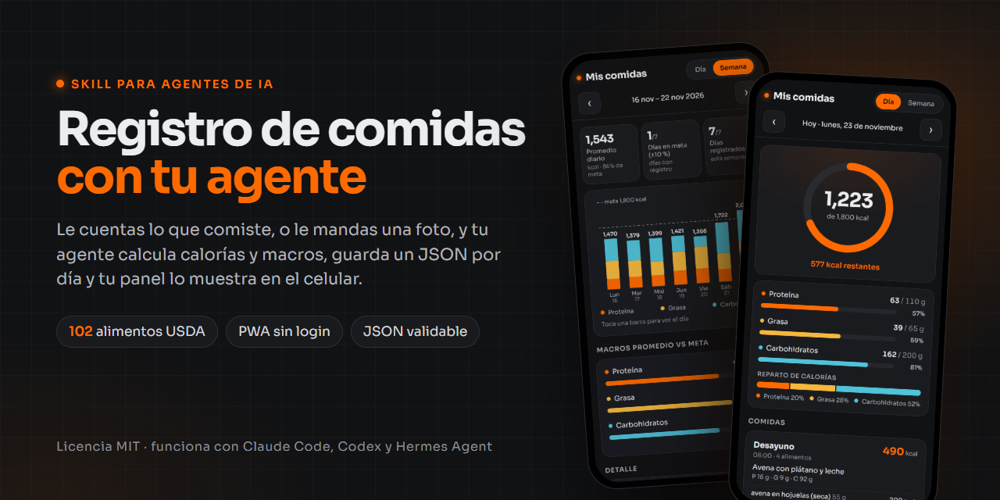
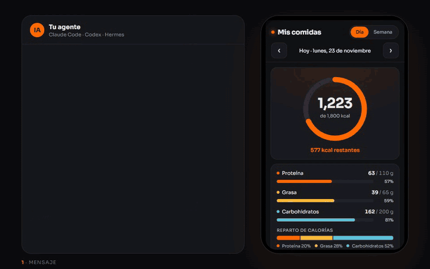
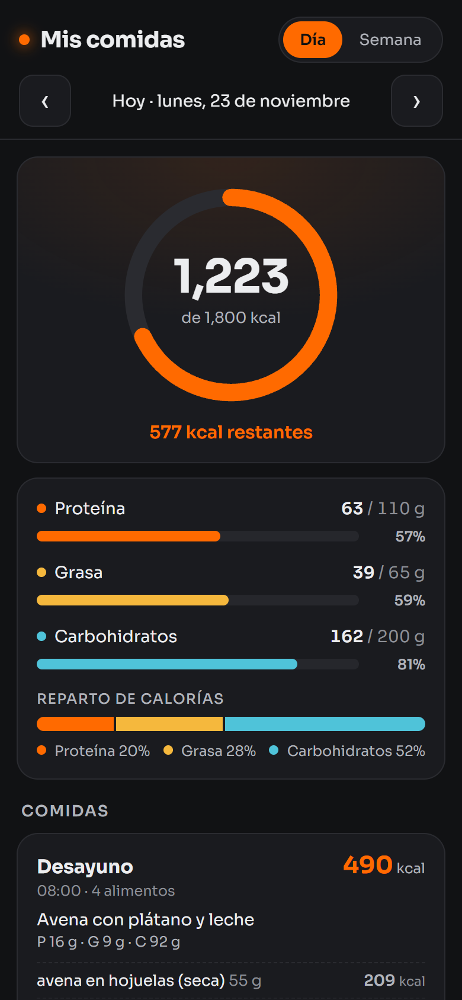
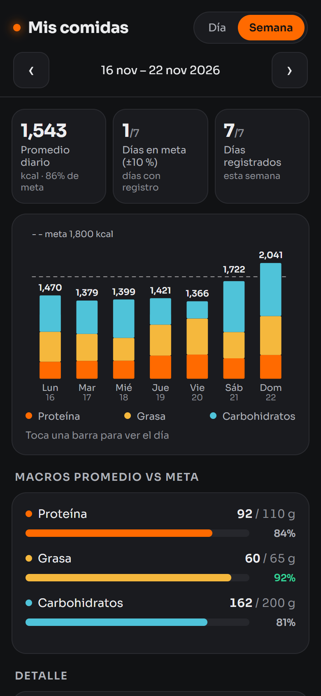

# Registro de comidas con agente

**Le cuentas a tu agente lo que comiste, o le mandas una foto, y él calcula calorías y macros con una
base pública, guarda un JSON por día y un panel instalable en el celular te muestra el día y la semana.**
Sin app, sin cuenta, sin suscripción y sin nube de terceros.

   



## El problema

Contar calorías funciona, pero las apps típicas te hacen buscar cada alimento en un buscador lleno de
duplicados, te piden cuenta, te muestran anuncios o te cobran por lo básico, y tus datos quedan en su
nube. Si ya hablas todo el día con un agente de IA, lo natural es decirle "almorcé arroz con pollo" y
que él haga el resto, pero un agente sumando calorías de cabeza se equivoca y edita archivos a mano
hasta romperlos.

## Qué hace

- **Registro conversacional:** describes la comida en lenguaje natural (o por voz o foto) y el agente
  la traduce a alimentos + cantidades, siguiendo reglas de porciones y de cuándo preguntar.
- **Aritmética determinista:** `scripts/registro.py` calcula kcal, proteína, grasa y carbohidratos
  desde la base y escribe el JSON de forma atómica. El agente interpreta; el script suma.
- **Base de 102 alimentos de USDA FoodData Central** (dominio público), cada uno con su `fdc_id`
  verificable, alias regionales (palta/aguacate, frejol/frijol) y porciones caseras.
- **Esquema JSON documentado y validable:** `validar_registro.py` revisa estructura, sumas e índice y
  dice el comando exacto que arregla cada error.
- **Panel estático PWA:** anillo de calorías vs. meta, macros, reparto calórico, comidas con
  ingredientes, semana con barras y promedios. HTML + JS + CSS sin dependencias (≈ 30 KB de código), se instala
  en el celular y abre sin conexión (interfaz, semana y los días que ya abriste).
- **Correcciones seguras:** quitar un ingrediente, mover una comida, recalcular, sin tocar JSON a mano.

## Demo

Mensaje → `registro.py` escribe y valida → el panel se recarga con el dato nuevo (grabación real, datos
inventados):



([versión MP4](assets/flujo.mp4))

| Día | Semana |
|---|---|
|  |  |

## Por qué es distinto

| | Apps de conteo (MyFitnessPal, Cronometer, Yazio) | Hoja de cálculo | **registro-comidas** |
|---|---|---|---|
| Cómo registras | Buscas y eliges cada alimento | Escribes todo a mano | Le hablas a tu agente (texto, voz o foto) |
| Dónde viven tus datos | En su nube, con cuenta | En tu archivo | En tus archivos JSON |
| Costo | Gratis con anuncios / pago para funciones | Gratis | Gratis (MIT) |
| Base de alimentos | Enorme, mezcla de datos verificados y de usuarios | La que armes | 102 genéricos USDA + los tuyos, cada uno con fuente |
| Escáner de código de barras | Sí | No | No (usa foto de la etiqueta) |
| Panel / gráficos | Sí | Lo que armes | Sí, estático e instalable |

No pretende competir en tamaño de base ni en escáner: su ventaja es que el registro se vuelve una
conversación y los datos son tuyos, en un formato abierto.

## Instalación

Requisitos: Python 3.8+ (solo biblioteca estándar) y un agente que lea `SKILL.md`. Para registrar por
foto, un modelo con visión. Probado en Windows 11; usa solo Python estándar y HTML/JS sin código
específico de sistema, por lo que debería funcionar igual en macOS y Linux (no probado ahí).

**Claude Code (marketplace):**

```
/plugin marketplace add vector-digital-studios/vector-digital-skills
/plugin install salud@vector-digital-skills
```

**Copia manual** (la carpeta `registro-comidas/` completa):

| Agente | Destino |
|---|---|
| Claude Code | `~/.claude/skills/registro-comidas/` |
| Codex | `~/.codex/skills/registro-comidas/` |
| Hermes Agent | `~/.hermes/skills/salud/registro-comidas/` |

Comprueba la instalación:

```bash
python ~/.claude/skills/registro-comidas/scripts/autoprueba.py   # → autoprueba: 40/40 comprobaciones OK
```

**Tu proyecto de comidas:** copia `templates/panel/` a donde quieras, borra los días de demo
(`data/AAAA-MM-DD.json` e `indice.json`) y pon tu meta en `config.json`. O pídeselo al agente:
*"configura registro-comidas en ~/comidas con meta de 2000 kcal"*.

## Uso

Le hablas al agente como siempre: *"desayuné avena con plátano"*, *"anoche cené un omelette de 3
huevos"*, *"corrige: el aceite no iba"*, *"¿cómo voy esta semana?"*. Por debajo, el agente corre esto
(salidas reales de esta versión):

**Buscar un alimento por su alias**

```
$ python scripts/registro.py --datos data buscar aguacate
palta  [grasa]  100 g: 167.0 kcal · P 1.96 · G 15.41 · C 8.64  | porciones: unidad=136.0 g
```

**Registrar una comida**

```
$ python scripts/registro.py --datos data agregar --fecha 2026-11-23 --comida Cena --hora 20:15 \
    --item "Omelette con champiñones y queso" --ing "huevo=3 unidad" --ing "champiñones=1 taza" \
    --ing "queso mozzarella=30 g" --ing "aceite vegetal=0.5 cucharada" --nota "3 huevos grandes; aceite asumido"
  huevo                            3 unidad      215 kcal  P 18.8 · G 14.3 · C 1.1
  champiñones                      1 taza         15 kcal  P 2.2 · G 0.2 · C 2.3
  queso mozzarella                 30 g            90 kcal  P 6.7 · G 6.6 · C 0.7
  aceite vegetal                   0.5 cucharada     62 kcal  P 0.0 · G 7.0 · C 0.0
  = Cena: 382 kcal · P 27.7 · G 28.1 · C 4.1
2026-11-23 · 4 comidas
  08:00 Desayuno      490 kcal  P 16 · G 9 · C 92
  13:15 Almuerzo      584 kcal  P 45 · G 23 · C 50
  17:00 Snack         150 kcal  P 2 · G 7 · C 20
  20:15 Cena          382 kcal  P 28 · G 28 · C 4
  Total 1605 / 1800 kcal (89%) · quedan 195
  Proteína 90/110 g · Grasa 67/65 g · Carbohidratos 166/200 g
```

**Corregir y validar**

```
$ python scripts/registro.py --datos data quitar --fecha 2026-11-23 --comida Cena --ingrediente "aceite vegetal"
  ...
  20:15 Cena          320 kcal  P 28 · G 21 · C 4
  Total 1543 / 1800 kcal (86%) · quedan 257

$ python scripts/validar_registro.py data        # alguien editó un total a mano:
ERROR 2026-11-20.json: daily_total.kcal = 1615.9 pero la suma de comidas da 1365.9 → corre 'registro.py recalcular --fecha 2026-11-20'
ERROR indice.json desactualizado en 2026-11-20 (kcal: 1365.9 vs 1615.9) → 'registro.py indice'
14 archivo(s) · 2 error(es) · 0 aviso(s) · FALLA
```

**Ver el panel**

```bash
cd ~/comidas && python -m http.server 8000      # http://localhost:8000
```

## Cómo funciona

```
 tú ──"cené un omelette…"──▶ agente (SKILL.md: reglas de porciones, cuándo preguntar, fotos)
                                 │  alimento + cantidad
                                 ▼
                       scripts/registro.py ──lee──▶ data/alimentos.json (USDA) + alimentos_propios.json
                                 │  calcula, escribe de forma atómica
                                 ▼
             data/2026-11-23.json  +  data/indice.json   ◀── validar_registro.py (exit 0/1)
                                 │
                                 ▼
          panel estático (index.html + app.js + styles.css + sw.js) ── Día · Semana · meta (config.json)
```

- **Esquema** de cada día: `date`, `meals[]` (nombre, hora, macros, `items`, `ingredients[]`, `note`),
  `daily_total` y `target` opcional. Detalle en `references/esquema.md` y JSON Schema en
  `references/esquema-dia.schema.json`.
- **Meta:** `config.json → meta` (kcal, proteína, grasa, carbohidratos); un día puede llevar su propio
  `target` para conservar metas antiguas.
- **Idioma del panel:** `config.json → idioma` = `es` o `en`.
- **Publicar:** local, red de casa, Vercel, Netlify o GitHub Pages; guía y advertencias de privacidad
  en `references/publicar.md`.

## Límites conocidos

- Son **estimaciones**: sin balanza siempre hay margen de error, mayor en fotos. La skill obliga al
  agente a declarar sus supuestos y ofrecer ajuste.
- La base trae **102 alimentos genéricos** de EE. UU.; platos regionales y productos con marca se
  estiman por ingredientes o se agregan a `alimentos_propios.json` con su fuente.
- **Sin escáner de código de barras** ni sincronización con relojes o apps de actividad.
- **Privacidad:** cualquier hosting estático público expone `data/*.json`. Usa local o un hosting con
  protección si no quieres que sea público.
- El panel lee archivos; cada registro nuevo necesita volver a desplegar si está en internet.
- **No es consejo médico ni nutricional.** La meta la fija el usuario o su profesional.

## Roadmap

- Base ampliada con tablas nacionales de composición de licencia abierta (platos latinoamericanos).
- Vista Mes y exportación CSV.
- Comando `registro.py importar` para etiquetas nutricionales leídas por foto.

## Origen y uso real

Nació como el módulo de Salud de un panel personal y fue la skill más usada de ese sistema: **340 usos
y 196 correcciones entre julio y octubre de 2026**, con registro diario por chat y por foto. De esa
experiencia salen las reglas de la skill (cuándo preguntar, grasa de cocción, porciones informales,
platos compartidos) y las dos fallas que este diseño elimina: sumas hechas por el modelo y JSON
editado a mano. Esta versión pública es una reescritura limpia: base de alimentos nueva y trazable,
panel extraído e independiente, y solo datos inventados.

## Créditos

- **USDA, Agricultural Research Service. FoodData Central — SR Legacy (abril 2018).** Dominio público
  (CC0 1.0). https://fdc.nal.usda.gov/ — origen de todos los valores de `data/alimentos.json`.
- **Sora** (The Sora Project Authors), SIL Open Font License 1.1, incluida en `templates/panel/fonts/`
  con su licencia.
- Referencia visual del panel original: apps de conteo como Fitia y Cal AI (solo inspiración de
  diseño; no se usa código ni datos de ellas).

## Licencia

MIT © Vector Digital. La fuente Sora mantiene su licencia OFL 1.1; los datos de USDA son de dominio público.

---

## English

**Tell your AI agent what you ate (or send a photo). It estimates calories and macros from a public
food database, saves one JSON file per day, and an installable static dashboard shows your day, your
week and your goal.** No app, no account, no subscription, no third-party cloud.

**The problem.** Calorie apps make you search every food in a noisy database, require an account, show
ads or paywall basics, and keep your data. Agents are a natural interface ("I had chicken and rice for
lunch"), but an LLM doing arithmetic in its head and hand-editing JSON breaks things.

**What it does.**
- Conversational logging by text, voice or photo, with explicit portion rules and when-to-ask rules.
- Deterministic math: `scripts/registro.py` computes kcal/protein/fat/carbs and writes atomically. The
  agent interprets; the script adds.
- 102 foods from **USDA FoodData Central SR Legacy** (public domain), each with a verifiable `fdc_id`,
  regional Spanish aliases and household portions.
- Documented, validated JSON schema (`validar_registro.py`, exit 0/1, tells you the fixing command).
- Dependency-free PWA dashboard (≈ 30 KB of code): calorie ring vs. goal, macros, meals with ingredients,
  weekly bars and averages; works offline (UI, week and days already opened); Spanish or English UI (`config.json → idioma: "en"`).
- Safe corrections: remove an ingredient, move a meal, recalculate.

**Why it's different.** Commercial apps win on database size and barcode scanning; this wins on
conversational logging, data ownership in open files, and zero cost. See the comparison table above.

**Install.** Python 3.8+ (stdlib only) and any agent that reads `SKILL.md` (Claude Code, Codex, Hermes
Agent); a vision model for photo logging.
Claude Code: `/plugin marketplace add vector-digital-studios/vector-digital-skills` then
`/plugin install salud@vector-digital-skills`. Manual: copy the folder to `~/.claude/skills/`,
`~/.codex/skills/` or `~/.hermes/skills/salud/`. Verify with `python scripts/autoprueba.py` (40/40).
Then copy `templates/panel/` to your own folder, delete the demo days, set your goal in `config.json`
and serve it with `python -m http.server 8000`.

**Usage.** Talk to your agent ("I had a 3-egg omelette for dinner"). Under the hood:
`registro.py buscar <text>`, `registro.py agregar --fecha … --comida … --ing "food=qty unit"`,
`registro.py quitar …`, `validar_registro.py data`. Real outputs are shown in the Spanish section above.

**Known limits.** Estimates, not measurements (larger error from photos); 102 generic US foods, so
regional dishes are estimated by ingredients or added to `alimentos_propios.json` with a source; no
barcode scanning or wearable sync; public static hosting exposes your `data/` folder unless protected;
not medical or nutrition advice. Food names and UI default to Spanish.

**Production use.** Extracted from a personal dashboard where it was the most-used skill: 340 uses and
196 corrections (Jul–Oct 2026). This public version is a clean rewrite with a new traceable food base,
an independent dashboard and invented demo data only.

**Credits.** USDA FoodData Central SR Legacy (public domain, CC0 1.0); Sora font (OFL 1.1). Visual
inspiration from calorie apps such as Fitia and Cal AI (no code or data used).

**License.** MIT © Vector Digital.
