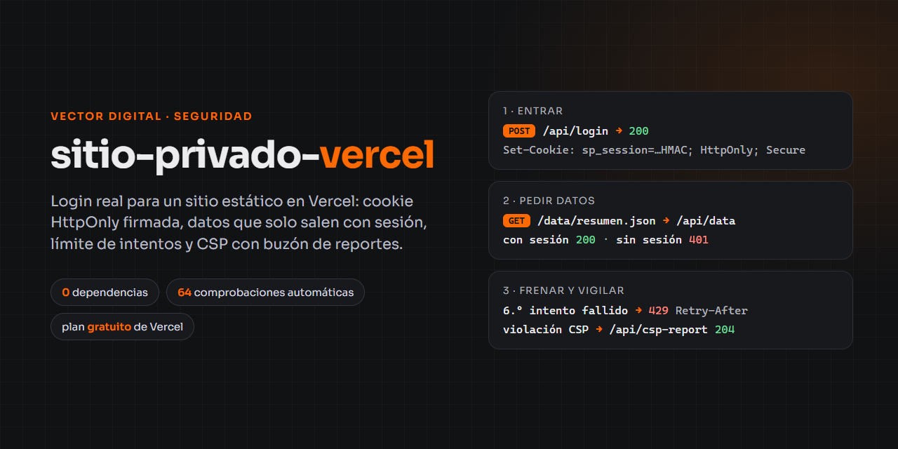
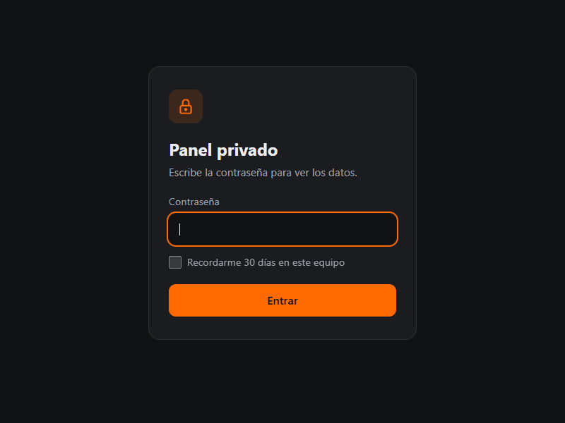
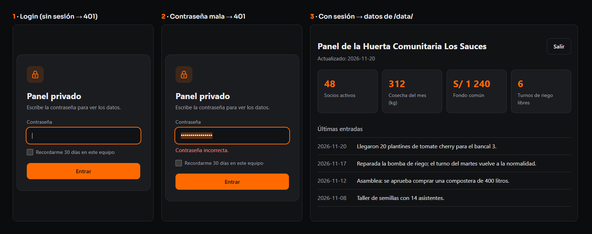
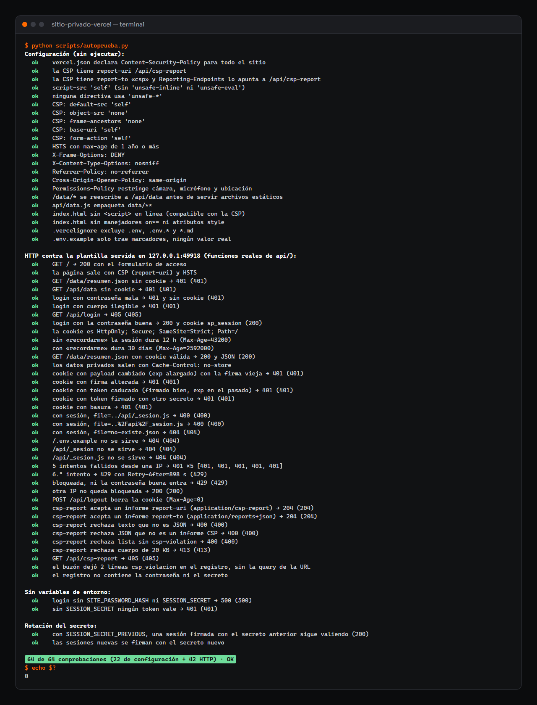

# sitio-privado-vercel

**Login real para un sitio estático en Vercel, sin dependencias: cookie HttpOnly firmada, datos que solo salen
con sesión, límite de intentos y CSP con buzón de reportes — con 64 pruebas que lo demuestran.**

  



## El problema

Publicar un panel personal o un informe privado en Vercel es fácil; cerrarlo bien, no. La salida rápida es un
candado en JavaScript que se salta desde DevTools y deja los JSON a un `curl` de distancia. La protección con
contraseña de Vercel es de pago y no existe en el plan gratuito, y montar Auth.js o Clerk para una sola
contraseña obliga a meter un framework, un SDK o una cuenta externa en un sitio que era HTML estático.

## Qué hace

- **Login en el servidor**: `POST /api/login` compara la contraseña con un hash **scrypt** en una variable de
  entorno y entrega una cookie `HttpOnly; Secure; SameSite=Strict` firmada con **HMAC-SHA256** (12 h, o 30
  días con «recordarme»). JavaScript no puede leerla.
- **Datos que solo salen con sesión**: el navegador pide `/data/resumen.json` como siempre, pero `vercel.json`
  lo manda a `/api/data`, que responde **401** sin cookie válida (manipulada, caducada o firmada con otro
  secreto) y bloquea rutas como `../`.
- **Límite de intentos**: 5 fallos por IP en 15 minutos → **429** con `Retry-After`. Configurable.
- **CSP estricta** (`script-src 'self'`, sin `unsafe-*`) con **buzón de reportes**: `report-uri` y
  `report-to` apuntan a `/api/csp-report`, que acepta los dos formatos de los navegadores, rechaza basura y
  deja una línea por violación en `vercel logs`. Más HSTS, `X-Frame-Options`, `nosniff`, `Referrer-Policy`,
  `Permissions-Policy`, COOP/CORP y `noindex`.
- **Rotación del secreto** sin expulsar a nadie (`SESSION_SECRET_PREVIOUS`) y **salida** (`/api/logout`).
- **Servidor local** que imita las `routes` de Vercel, las funciones y `.vercelignore`, para probar sin cuenta.
- **Autoprueba**: 64 comprobaciones reales por HTTP contra las funciones, sin red externa ni llaves.

## Demo







Todo con datos inventados (una huerta comunitaria de ejemplo).

## Por qué es distinto

| | sitio-privado-vercel | Password Protection de Vercel | Auth.js | Clerk | Basic Auth en middleware |
|---|---|---|---|---|---|
| Coste | 0 (plan Hobby) | 20 USD/mes por proyecto en Pro; no disponible en Hobby | 0 (código abierto) | Plan gratuito con límites; de pago al crecer | 0 |
| Qué necesita | HTML estático + 4 funciones Node, 0 dependencias | Nada (lo gestiona Vercel) | Un framework con servidor y sus paquetes npm | Su SDK y una cuenta en su servicio | Un archivo de middleware |
| Usuarios | Una contraseña compartida | Una contraseña compartida | Muchos usuarios, OAuth, correo | Muchos usuarios, OAuth, MFA | Una o pocas credenciales |
| Página de acceso propia y salida | Sí | Página de Vercel | Sí | Sí (componentes) | Diálogo del navegador, sin salida real |
| Límite de intentos | Sí (por instancia) | No documentado | No de serie | Sí (bloqueo de cuenta) | No de serie |
| CSP y buzón de reportes incluidos | Sí | No | No | No | No |
| Pruebas incluidas | 64 comprobaciones | — | Las de la librería | — | — |

Es la opción para **una persona o un grupo pequeño con una contraseña**. Si necesitas cuentas por usuario,
permisos o inicio con Google, usa Auth.js o Clerk. Si pagas Vercel Pro y no necesitas una página propia,
Password Protection es lo más simple. Precios consultados en la documentación de Vercel en nov-2026.

## Instalación

Requisitos: **Node 18+** (las funciones y el servidor local; probado con Node 22) y **Python 3** solo para la
autoprueba (biblioteca estándar). Para publicar: cuenta de Vercel (el plan gratuito sirve) y su CLI.

**Claude Code** (como plugin):
```
/plugin marketplace add vector-digital-studios/vector-digital-skills
/plugin install seguridad@vector-digital-skills
```

**Copia manual** (Claude Code, Codex, Hermes o cualquier agente que lea `SKILL.md`):
```bash
cp -r sitio-privado-vercel ~/.claude/skills/        # o ~/.codex/skills/  o  ~/.hermes/skills/seguridad/
python ~/.claude/skills/sitio-privado-vercel/scripts/autoprueba.py
# … 64 de 64 comprobaciones (22 de configuración + 42 HTTP) · OK
```

## Uso

**1. Pedírselo al agente**
> «Carga sitio-privado-vercel y ponle login a mi panel de la carpeta `panel/`; los JSON de `datos/` no pueden
> quedar públicos.»

El agente copia la plantilla, mueve los JSON a `data/`, saca los scripts en línea a `js/` para que la CSP no
los bloquee, te pide que generes las claves tú (`node scripts/generar_claves.cjs`) y verifica con la
autoprueba antes de desplegar con la guía `references/despliegue.md`.

**2. Probar la plantilla en tu equipo, sin cuenta de Vercel**
```bash
printf '%s' 'huerta-demo-2026-claveLarga' | node scripts/generar_claves.cjs > .env.local
node scripts/servidor_local.cjs --port 3999 --env .env.local
# LISTO http://127.0.0.1:3999

curl -s -o /dev/null -w '%{http_code}\n' http://127.0.0.1:3999/data/resumen.json
# 401
curl -s -w ' %{http_code}\n' -H 'Content-Type: application/json' -d '{"password":"otra"}' http://127.0.0.1:3999/api/login
# {"error":"invalid"} 401
curl -s -c jar.txt -w ' %{http_code}\n' -H 'Content-Type: application/json' \
     -d '{"password":"huerta-demo-2026-claveLarga"}' http://127.0.0.1:3999/api/login
# {"ok":true} 200
curl -s -b jar.txt http://127.0.0.1:3999/data/resumen.json | head -n 2
# {
#   "titulo": "Panel de la Huerta Comunitaria Los Sauces",
```
(La contraseña en `printf` es solo para la demo; en serio, ejecuta `generar_claves.cjs` sin tubería y te la
pide sin mostrarla.)

**3. Comprobar que todo sigue cerrado después de tocar algo**
```bash
python scripts/autoprueba.py
#   ok    GET /data/resumen.json sin cookie → 401 (401)
#   ok    la cookie es HttpOnly; Secure; SameSite=Strict; Path=/
#   ok    cookie con token caducado (firmado bien, exp en el pasado) → 401 (401)
#   ok    6.º intento → 429 con Retry-After=898 s (429)
#   ok    csp-report rechaza texto que no es JSON → 400 (400)
#   …
# 64 de 64 comprobaciones (22 de configuración + 42 HTTP) · OK
```

## Cómo funciona

```
navegador                         Vercel (vercel.json → routes)                 funciones (api/)
─────────                         ─────────────────────────────                 ────────────────
GET /                ─────────►   cabeceras CSP/HSTS/… → index.html estático
POST /api/login      ─────────►                                         ─────►  login.js: scrypt(clave) == hash?
                     ◄─────────   Set-Cookie: sp_session=<payload>.<HMAC>; HttpOnly; Secure; SameSite=Strict
GET /data/x.json     ─────────►   /data/(.*) → /api/data?file=$1 (antes de servir archivos) ─►  data.js:
                     ◄─────────   200 + JSON (no-store) con firma válida y sin caducar · 401 si no
violación de CSP     ─────────►   POST /api/csp-report                  ─────►  csp-report.js → vercel logs
```

- **Token**: `base64url({"exp":…,"v":1})` + `.` + `HMAC-SHA256(payload, SESSION_SECRET)`. Sin estado en el
  servidor; la comparación de firmas es de tiempo constante (`timingSafeEqual`).
- **Hash de la contraseña**: `scrypt$<sal>$<hash>` (Node `crypto.scryptSync`, N=16384, r=8, p=1).
- **Orden de rutas**: `/data/(.*)` va antes de `"handle": "filesystem"`, así el JSON nunca sale como archivo
  estático aunque esté en la carpeta; `api/data.js` lo empaqueta con `includeFiles: "data/**"`.
- **Sin estilos ni scripts en línea**: `index.html` solo carga `/js/app.js` y `/css/estilos.css`, por eso la
  CSP puede ser `script-src 'self'; style-src 'self'`.

## Configuración

| Variable | Obligatoria | Qué es |
|---|---|---|
| `SITE_PASSWORD_HASH` | Sí | `scrypt$<sal>$<hash>` de `generar_claves.cjs` (o SHA-256 hex, solo con contraseñas aleatorias largas) |
| `SESSION_SECRET` | Sí | 32+ caracteres aleatorios; firma las cookies |
| `SESSION_SECRET_PREVIOUS` | No | Secreto anterior, solo para verificar durante una rotación |
| `LOGIN_MAX_ATTEMPTS` | No | Fallos antes del 429 (5) |
| `LOGIN_WINDOW_MINUTES` | No | Ventana del límite (15) |
| `LOGIN_FAIL_DELAY_MS` | No | Pausa antes de responder un fallo (400) |
| `SESSION_COOKIE_NAME` | No | Nombre de la cookie (`sp_session`) |

Sin `SITE_PASSWORD_HASH` o con un `SESSION_SECRET` corto, el login responde 500 y ningún token vale: falla
cerrado. La guía completa (CLI, verificación con curl, rotación, Deployment Protection) está en
[`references/despliegue.md`](references/despliegue.md).

## Probado en producción

El patrón sale del login de un panel personal en Vercel, en producción desde el **5-ago-2026**; el límite de
intentos y el buzón CSP se añadieron el **17-nov-2026** tras una auditoría propia. Las tres guías internas de
las que nace la skill sumaron 69 usos por el agente. Esta plantilla es la versión limpia y genérica: se probó
en local (autoprueba, Chrome real contra el servidor local y contra un proxy HTTPS), **no** se desplegó como
proyecto nuevo.

## Límites conocidos

- **El límite de intentos vive en la memoria de cada instancia.** Vercel puede repartir peticiones entre
  varias instancias y reiniciarlas, así que un atacante paciente consigue más de 5 intentos por ventana. Es un
  freno, no un muro: la defensa principal es una contraseña larga y aleatoria. Para un tope global, cambia el
  `Map` por Redis (p. ej. Upstash desde el Marketplace de Vercel); no viene incluido para no añadir cuentas.
- **Una sola contraseña compartida**, sin usuarios, roles ni registro de quién entró.
- **Cerrar sesión no invalida el token en el servidor** (no hay estado): si una cookie se filtra, vale hasta
  que caduque o hasta que rotes `SESSION_SECRET`.
- **`report-to` necesita HTTPS**: en `http://127.0.0.1` Chrome no envía informes; detrás de HTTPS sí (probado con un
  proxy HTTPS local).
- El servidor local es una **aproximación** de Vercel (routes, funciones, `.vercelignore`), no un emulador
  completo; la referencia final es un despliegue de vista previa.
- `"handle": "filesystem"` figura como deprecado en la documentación actual de Vercel (sigue soportado y es lo
  que está en producción).
- `x-forwarded-for` es fiable en Vercel (lo reescribe la plataforma); detrás de otro proxy, revísalo.

## Roadmap

- Adaptador opcional de límite de intentos con Redis (Upstash), activado solo si hay variables.
- Variante con `rewrites` modernos cuando se pueda demostrar el mismo orden frente a archivos estáticos.
- Prueba de humo con navegador dentro de la autoprueba (hoy está aparte).

## Créditos

- Código y textos propios de Vector Digital (MIT). Sin código de terceros ni dependencias.
- Referencias consultadas: documentación de Vercel (`vercel.json`, Deployment Protection y sus precios), MDN y
  Chrome for Developers (CSP, `report-to`, `Reporting-Endpoints`). No se copia texto de ellas.

## Licencia

MIT. Ver el archivo `LICENSE` en la raíz del repositorio.

---

## English

**Real login for a static site on Vercel, zero dependencies: signed HttpOnly cookie, data served only with a
valid session, login rate limiting and a CSP with a report endpoint — backed by 64 automated checks.**

**The problem.** A JavaScript-only lock on a static site is bypassed from DevTools and leaves the JSON files
one `curl` away. Vercel's Password Protection is paid (USD 20/month per project on Pro, not available on
Hobby), and Auth.js or Clerk are heavy for a single shared password on a plain HTML site.

**What it does.**
- `POST /api/login` checks the password against a **scrypt** hash in an env var and sets an `HttpOnly; Secure;
  SameSite=Strict` cookie signed with **HMAC-SHA256** (12 h, or 30 days with "remember me").
- `/data/*.json` is routed to `/api/data` *before* static files are served: **401** without a valid cookie
  (tampered, expired or signed with another secret), path traversal blocked, `Cache-Control: no-store`.
- 5 failed logins per IP in 15 min → **429** with `Retry-After` (configurable).
- Strict CSP (`script-src 'self'`, no `unsafe-*`) with `report-uri` + `report-to` → `/api/csp-report`, which
  accepts both browser formats, rejects junk (400/413) and logs one line per violation to `vercel logs`. Plus
  HSTS, `X-Frame-Options`, `nosniff`, `Referrer-Policy`, `Permissions-Policy`, COOP/CORP, `noindex`.
- Secret rotation without logging everyone out (`SESSION_SECRET_PREVIOUS`), `/api/logout`, a local server
  that mimics Vercel `routes`/functions/`.vercelignore`, and `scripts/autoprueba.py` (64 real HTTP checks, no
  network, no keys).

**Install.** Claude Code: `/plugin marketplace add vector-digital-studios/vector-digital-skills`, then
`/plugin install seguridad@vector-digital-skills`. Or copy the folder to `~/.claude/skills/`,
`~/.codex/skills/` or `~/.hermes/skills/seguridad/`. Requires Node 18+ (tested on 22); Python 3 stdlib for
the self-test.

**Use.** `node scripts/generar_claves.cjs` (prompts for the password without echoing it) →
`SITE_PASSWORD_HASH` and `SESSION_SECRET`; `node scripts/servidor_local.cjs --env .env.local` to try it
locally; `python scripts/autoprueba.py` → `64 de 64 comprobaciones … · OK`; deploy following
`references/despliegue.md` (`vercel env add … --sensitive`, `vercel deploy --prod`, curl checks).

**Known limits.** The rate limit lives in each function instance's memory (a brake, not a wall — use a long
random password, or plug in Redis for a global limit). One shared password, no users. Logout clears the cookie
but tokens are stateless: rotate `SESSION_SECRET` to revoke all sessions. `report-to` needs HTTPS. The local
server approximates Vercel; a preview deployment is the final reference. `"handle": "filesystem"` is marked
deprecated in current Vercel docs but still supported.

**Production.** The pattern has run on a personal dashboard on Vercel since Aug 5, 2026 (rate limit and CSP
reporting since Nov 17, 2026). This clean template was tested locally (self-test, real Chrome against the
local server and an HTTPS proxy); it was not deployed as a new project.

**License.** MIT. No third-party code.
