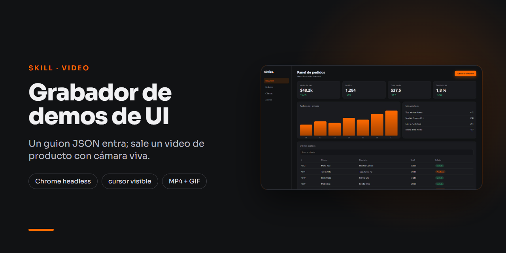
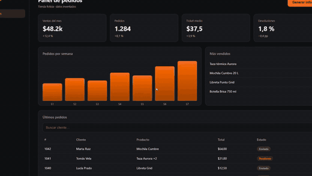
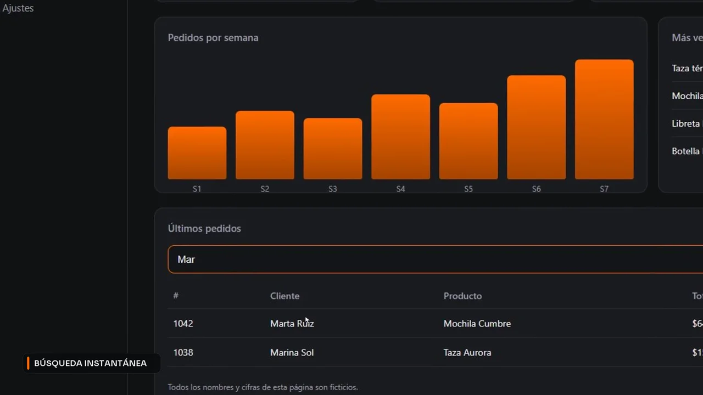

# Grabador de demos de UI

**Escribe un guion JSON con lo que harías con el ratón; obtén un video 1080p de tu producto con cámara que sigue al puntero, zoom en los clics, cursor visible y GIF para el README.**

   



## El problema
Cada vez que cambia la interfaz, el video de demo queda viejo. Grabar la pantalla a mano exige
repetir la toma hasta que el ratón no tiemble, ocultar pestañas y notificaciones, y luego editar zooms
en un programa de pago. Playwright puede grabar video, pero sale plano: sin cursor, sin cámara, sin ritmo.

## Qué hace
- Lanza Chrome/Chromium/Edge en headless y ejecuta un **guion de acciones** (ir, esperar, mover, hover,
  clic, escribir, scroll, pestaña nueva) con movimiento de ratón humano.
- Captura el **screencast real** del navegador y registra la posición del puntero en cada frame.
- Monta un **MP4 1920x1080**: cámara con muelle amortiguado que sigue al puntero, **zoom automático**
  hacia cada clic y escritura, **cursor dibujado** con animación de pulsación, rótulos opcionales y
  fundido entre segmentos.
- Exporta **GIF** con paleta optimizada (≤2 MB para README con los parámetros recomendados).
- Sin dependencias npm: CDP por el `WebSocket` nativo de Node 22. Montaje con Pillow + ffmpeg.

## Demo
Video grabado y montado **por esta herramienta** sobre la app ficticia incluida
(`templates/app-demo/index.html`), con el guion `templates/guion-ejemplo.json` y el montaje
`templates/montaje-ejemplo.json`. Nada editado a mano.



MP4 1080p (13 s, 2,8 MB): [assets/demo.mp4](assets/demo.mp4) · Fotograma a resolución completa:



## Por qué es distinto
| | Esta skill | Video nativo de Playwright | Screen Studio / Arcade | Grabar a mano (OBS) |
|---|---|---|---|---|
| Reproducible desde código | Sí (guion JSON) | Sí | No | No |
| Cursor visible | Sí, dibujado | No | Sí | Sí |
| Cámara que sigue al puntero y zoom | Sí, automático | No | Sí | No (edición manual) |
| Coste | Gratis, MIT | Gratis | De pago | Gratis |
| Corre en servidor/CI sin pantalla | Sí | Sí | No | No |
| Apps de escritorio nativas | No | No | Sí | Sí |

Honestamente: Screen Studio da más control artístico y graba cualquier app; esto gana cuando la demo
tiene que **regenerarse sola** cada vez que cambia la web, o la produce un agente.

## Instalación
**Claude Code (marketplace):**
```
/plugin marketplace add vector-digital-studios/vector-digital-skills
/plugin install video@vector-digital-skills
```
**Copia manual** de la carpeta `grabador-demos-ui/` a:
- Claude Code: `~/.claude/skills/grabador-demos-ui/`
- Codex: `~/.codex/skills/grabador-demos-ui/`
- Hermes Agent: `~/.hermes/skills/video/grabador-demos-ui/`

Funciona con cualquier agente que lea `SKILL.md`; los scripts también se usan solos desde la terminal.

**Requisitos:** Node.js 22+, Chrome/Chromium/Edge, Python 3.9+ con Pillow, ffmpeg con libx264.
Comprueba tu entorno con `python scripts/autoprueba.py`.

## Uso
**1. Grabar y montar la demo de ejemplo (comandos reales, salida real):**
```bash
node scripts/grabar.js templates/guion-ejemplo.json --out salida-demo
# chrome: chrome.exe · puerto 63791 · viewport 1600x900
# ok goto (896 ms) … ok hover (1799 ms)
# segmento panel: 362 frames, 14.7 s, recorrido del puntero 4181 px
# LISTO …/salida-demo

python scripts/montar.py salida-demo --mp4 demo.mp4 --gif demo.gif --gif-ancho 520 --gif-fps 8 --gif-colores 32
# segmentos [429] · 429 frames · 14.3 s · 1920x1080
# OK demo.mp4 (2.94 MB)
```
Con Python sin Pillow: `uv run --with pillow python scripts/montar.py …`.

**2. Pedírselo al agente:**
> «Graba una demo de 15 s de http://localhost:3000: entra, pasa por las métricas, crea un proyecto
> llamado "Prueba" y muestra el resultado. Entrégame MP4 y GIF para el README.»

El agente escribe el guion (`references/guion.md`), graba, monta, extrae fotogramas y los revisa.

**3. Montaje fino con rótulos** (`templates/montaje-ejemplo.json`):
```json
{ "root": "../salida-demo", "auto_zoom": {"base": 1.12, "foco": 1.5},
  "segments": [{ "dir": "frames-panel", "speed": 1.1,
    "captions": [[0.4, 3.2, "KPIS DEL MES, DE UN VISTAZO"], [9.0, 12.4, "BÚSQUEDA INSTANTÁNEA"]] }] }
```

## Cómo funciona
```
guion.json ──► grabar.js ──(CDP: Input.dispatchMouseEvent + Page.startScreencast)──► Chrome headless
                  │
                  └─► frames-<seg>/f00000.jpg … + frames.json {i,x,y,t} + eventos.json {t,tipo}
                                         │
                       montar.py ◄───────┘  línea de tiempo real (cadencia variable)
                         · muelle crítico cámara→puntero + deriva sutil
                         · zoom automático por eventos o keyframes
                         · cursor + pulsación + rótulos + fundidos
                         └─► ffmpeg (rawvideo → libx264) ─► MP4 ─► GIF (palettegen)
```
Detalles: `references/guion.md` (pasos), `references/montaje.md` (claves), `references/guia-camara.md`
(cámara, zoom, ritmo y control de calidad).

## Configuración
- `CHROME_PATH` o `--chrome`: navegador a usar. `--headful` para verlo mientras graba.
- `FFMPEG`: binario de ffmpeg si no está en PATH.
- `GRABADOR_TMP`: dónde crear el perfil temporal de Chrome (se borra al terminar).
- Credenciales en el guion como `"$ENV:NOMBRE"`; nunca en texto plano.

## Límites conocidos
- Solo web (Chromium). No graba apps nativas ni el escritorio.
- El montaje corre en un hilo: ≈0,19 s por frame 1080p en un portátil (14 s de video ≈ 80 s).
- El screencast es de cadencia variable: en páginas muy estáticas llegan menos frames (el cursor
  se interpola entre ellos; el movimiento se ve bien, pero `hover` sin cambio visual no añade frames).
- Sin audio ni música: se añade después en tu editor o con ffmpeg.
- Probado en Windows 11 con Google Chrome de sistema y con el Chromium que instala Playwright. Edge y la
  autodetección en macOS/Linux están escritas pero **no se han probado** aún.
- Las páginas con login real requieren cuentas de demo; respeta los términos del sitio que grabes.

## Roadmap
- Tratamiento "pantalla inclinada" (perspectiva) y modo tarjeta como opción del montaje.
- Música y efectos de clic opcionales.
- Montaje en paralelo por bloques de frames.

## Créditos
- Fuente **Sora** (© The Sora Project Authors) bajo SIL Open Font License 1.1: `templates/fonts/OFL-Sora.txt`.
- Usa Chrome DevTools Protocol, Pillow (licencia HPND/MIT-CMU) y ffmpeg (LGPL/GPL, se invoca como
  programa externo, no se distribuye).
- Desarrollada y usada internamente por Vector Digital Studios (16 usos internos desde sep-2026).

## Licencia
MIT. Ver `LICENSE` en la raíz del repositorio.

---

## English

**UI demo recorder** — write a JSON script of what you would do with the mouse; get a 1080p product
video with a pointer-following camera, auto-zoom on clicks, a visible cursor and a README-ready GIF.

**Problem:** demo videos go stale with every UI change; screen recording by hand means retakes,
hiding tabs and editing zooms in paid tools. Playwright's native video is flat (no cursor, no camera).

**What it does:** launches headless Chrome/Chromium/Edge, runs a scripted journey (goto, wait, move,
hover, click, type, scroll, new tab) with human-like pointer motion, captures the real browser
screencast plus pointer positions, and renders an MP4 with a critically-damped spring camera, automatic
zoom towards clicks/typing, a drawn cursor with press animation, optional captions and crossfades,
plus an optimized GIF. No npm dependencies (Node 22 native WebSocket); Pillow + ffmpeg for montage.

**Demo:** `assets/demo.gif` / `assets/demo.mp4` were recorded and rendered by this tool on the bundled
fictional app (`templates/app-demo/`) with `templates/guion-ejemplo.json`. No manual editing.

**Install:** `/plugin marketplace add vector-digital-studios/vector-digital-skills` then
`/plugin install video@vector-digital-skills`, or copy the folder to `~/.claude/skills/`,
`~/.codex/skills/` or `~/.hermes/skills/video/`. Requires Node 22+, Chrome/Chromium/Edge,
Python 3.9+ with Pillow, ffmpeg with libx264. Run `python scripts/autoprueba.py` to check.

**Usage:**
```bash
node scripts/grabar.js templates/guion-ejemplo.json --out salida-demo
python scripts/montar.py salida-demo --mp4 demo.mp4 --gif demo.gif
```
Script steps, montage keys and camera/zoom/pacing rules are documented (in Spanish) in `references/`.
Key rule: the camera follows the pointer, so the script must make the pointer travel thousands of px.

**Limits:** web only; single-threaded montage (~0.19 s per 1080p frame); variable-rate screencast on
static pages; no audio; tested on Windows 11 with Chrome and Playwright Chromium only (Edge and macOS/Linux detection untested).

**Credits:** Sora font (OFL 1.1). Built and used in-house by Vector Digital Studios (16 internal uses
since Sep 2026). **License:** MIT.
